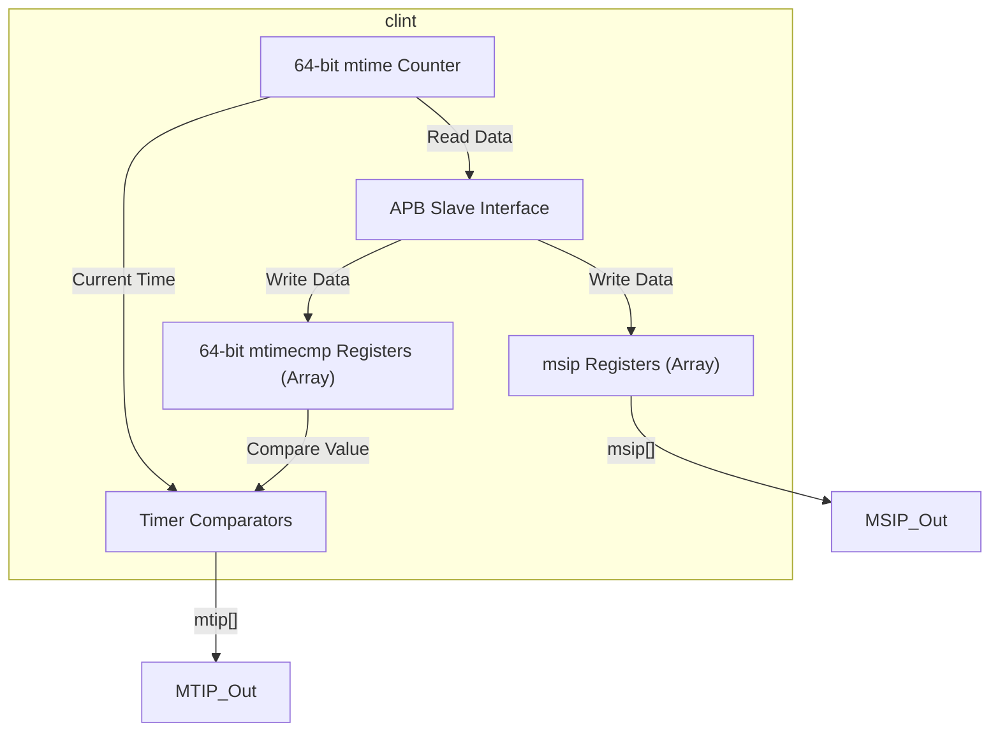
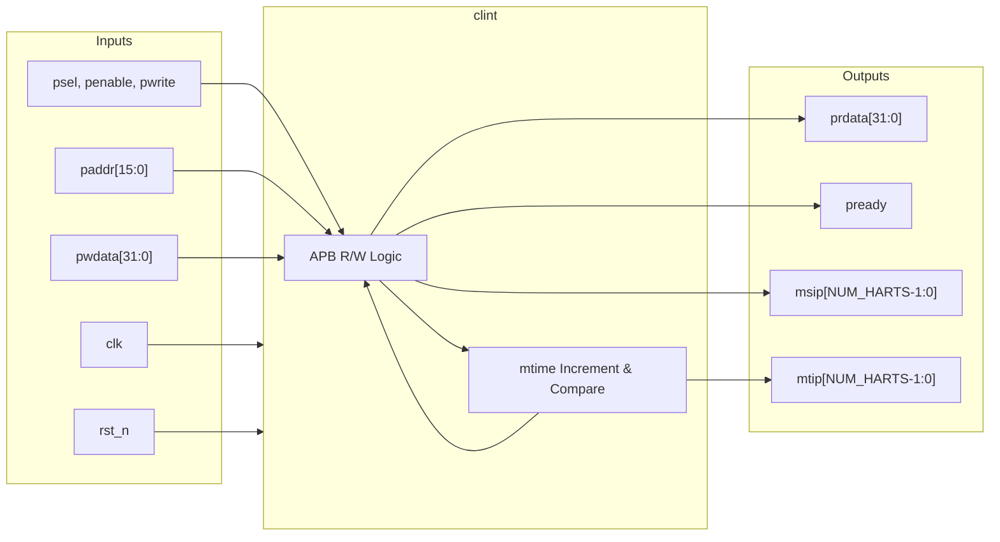
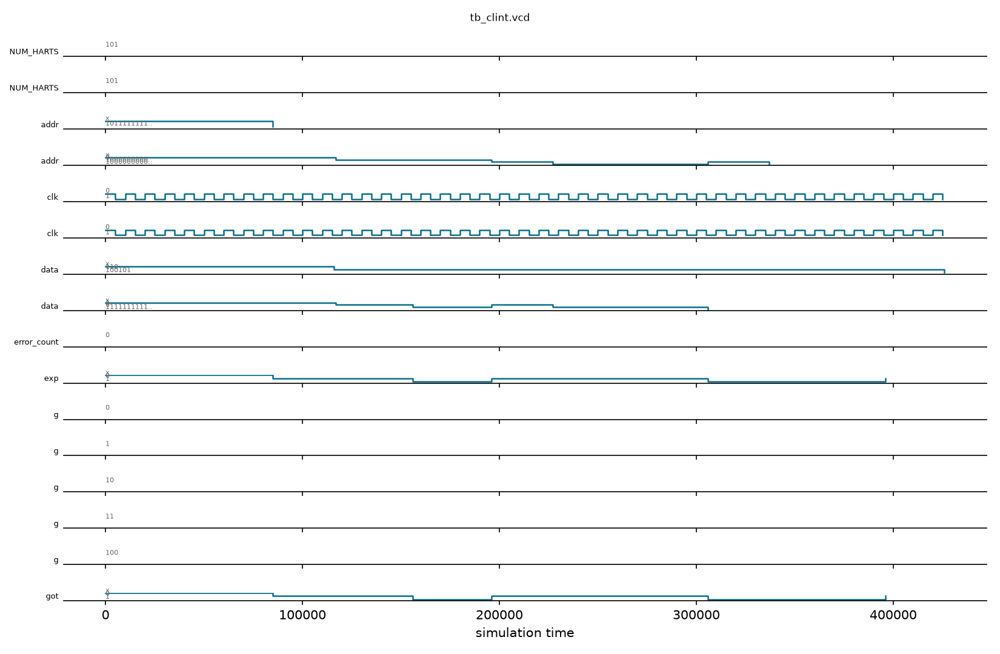

# clint

## Description

The `clint` (Core-Local Interruptor) module generates precise software and timer interrupts for the SMVDU-TITAN-X SoC in accordance with the RISC-V Privileged Architecture. It provides a centralized 64-bit real-time counter (`mtime`) and supports up to 5 hardware threads (harts). For each hart, it maintains a memory-mapped 64-bit time comparator (`mtimecmp`) and a Machine Software Interrupt Pending register (`msip`). The module features an APB slave interface for fast, memory-mapped configuration by the operating system.

## Interface

### Inputs

| Signal | Width | Description |
|--------|-------|-------------|
| clk | 1 | System clock |
| rst_n | 1 | Active-low asynchronous reset |
| psel | 1 | APB select signal |
| penable | 1 | APB enable signal |
| pwrite | 1 | APB write strobe |
| paddr | 16 | APB 16-bit address for memory-mapped I/O |
| pwdata | 32 | APB 32-bit write data |

### Outputs

| Signal | Width | Description |
|--------|-------|-------------|
| prdata | 32 | APB 32-bit read data returning to the master |
| pready | 1 | APB ready signal, always asserted for zero-wait access |
| msip | NUM_HARTS | Machine Software Interrupt Pending signals (one per hart) |
| mtip | NUM_HARTS | Machine Timer Interrupt Pending signals (one per hart) |

## Functionality

The `clint` module maintains a 64-bit internal register (`mtime`) that increments by one on every clock cycle. It concurrently compares this master time against 5 independent 64-bit `mtimecmp` registers (one for each supported hart). Whenever `mtime` is greater than or equal to a hart's `mtimecmp` value, the corresponding `mtip` (Machine Timer Interrupt Pending) output is asserted. Software interrupts are managed via the `msip` register block. The module exposes these registers through a standard APB slave interface mapped to specific address ranges: `0x0000` for `msip`, `0x4000` for `mtimecmp`, and `0xBFF8` for `mtime`. Since `mtime` and `mtimecmp` are 64-bit, the 32-bit APB interface writes to them in two separate 32-bit halves (lower and upper).

## Hierarchical Block Diagram



## Signal-Level Diagram



## Verification & Simulation Results

### Verification Strategy
The `clint` module was verified using a directed self-checking testbench (`tb_clint.v`) testing APB register transactions, 64-bit real-time counter incrementation, and timer interrupt comparators:
1. **Reset State:** Confirms active-low reset initializes `pready = 1` (zero-wait APB) and clears all hart software interrupts (`msip = 5'b00000`).
2. **Real-Time Counter Incrementation:** Reads `mtime_lo` (`0xBFF8`) over APB and confirms continuous monotonic incrementation every cycle.
3. **Software Interrupt Generation & Clearing:** Performs APB write to `msip[0]` (`0x0000`), verifying immediate assertion of `msip[0] = 1`, followed by clearing back to 0.
4. **Timer Comparator Matching (`mtip`):** Programs `mtimecmp[0]` (`0x4000/0x4004`) to a low threshold ($1$), verifying that `mtip[0]` asserts as soon as `mtime >= mtimecmp[0]`.
5. **Timer Clearing:** Re-programs `mtimecmp[0]` to `0xFFFFFFFFFFFFFFFF` and confirms immediate deassertion of `mtip[0]`.

### Simulation Transcript
```text
VCD info: dumpfile tb_clint.vcd opened for output.

--- TEST 1: Reset state ---
PASS [85000]             pready=1 (zero-wait)
PASS [85000]               msip=0 after reset

--- TEST 2: mtime increments ---
  mtime_lo after reset+3 cycles = 0x00000006 (non-zero expected)
PASS [117000] mtime_lo > 0 (incrementing)

--- TEST 3: msip[0] set ---
PASS [156000]            msip[0]=1 after write

--- TEST 4: msip[0] clear ---
PASS [196000]            msip[0]=0 after clear

--- TEST 5: mtip generation ---
PASS [306000] 0]=1 when mtime >= mtimecmp[0]=1

--- TEST 6: mtip cleared by large mtimecmp ---
PASS [396000]      mtip[0]=0 when mtimecmp=max

--- TEST 7: mtime readback ---
  mtime_lo = 0x00000025 (incremented)
PASS [427000] mtime_lo > 16 after running

==============================
CLINT VERDICT: ✅ PASS — All tests passed
==============================
```

### Digital Waveform


