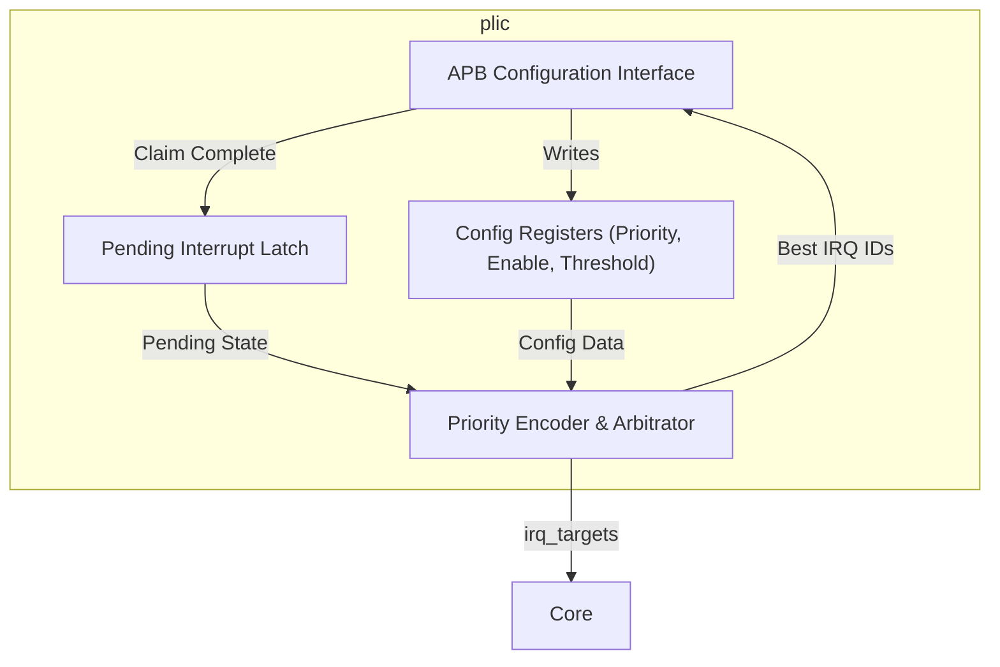
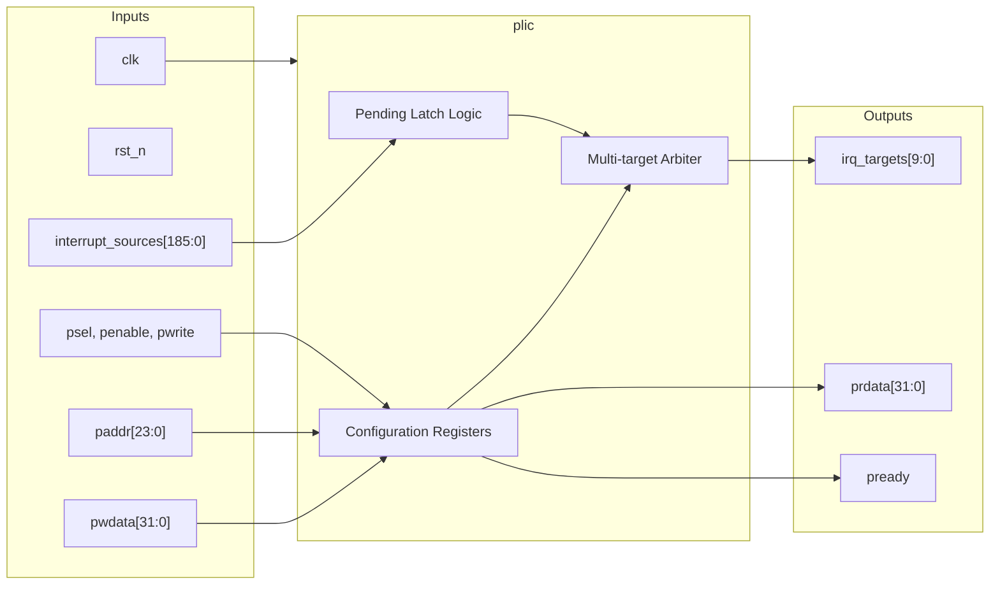

# plic

## Description

The `plic` (Platform Level Interrupt Controller) routes external hardware interrupts to specific hart contexts in the SMVDU-TITAN-X SoC. It scales to handle 186 independent global interrupt sources and routes them to 10 distinct targets (representing Machine and Supervisor privilege modes across 5 hardware threads). The PLIC evaluates incoming interrupts dynamically, considering per-source priorities, per-target enables, and per-target priority thresholds. It exposes an APB slave interface to allow system software to configure these parameters, read interrupt claims, and signal completion of interrupt service routines.

## Interface

### Inputs

| Signal | Width | Description |
|--------|-------|-------------|
| clk | 1 | System clock |
| rst_n | 1 | Active-low asynchronous reset |
| interrupt_sources | 186 | Raw external interrupt signals from peripherals |
| psel | 1 | APB select signal |
| penable | 1 | APB enable signal |
| pwrite | 1 | APB write strobe |
| paddr | 24 | APB 24-bit address for configuration registers |
| pwdata | 32 | APB 32-bit write data |

### Outputs

| Signal | Width | Description |
|--------|-------|-------------|
| prdata | 32 | APB 32-bit read data returning to the master |
| pready | 1 | APB ready signal, always asserted for zero-wait access |
| irq_targets | 10 | Resolved interrupt request lines directed to the 10 core targets |

## Functionality

The `plic` captures the rising edges of 186 `interrupt_sources` into its internal `pending` register array. On every cycle, a combinational priority encoder evaluates all pending interrupts against the configuration matrix. For each of the 10 targets, the PLIC checks if the pending interrupt is enabled (`enable` array), and if its assigned priority (`priority_reg`) strictly exceeds the target's configured `threshold`. It selects the highest-priority valid interrupt for each target and asserts the corresponding bit in `irq_targets`. 

System software interacts with the PLIC via the APB interface. When a target receives an interrupt, it reads the claim register to get the ID of the highest-priority pending interrupt, which automatically acknowledges it. After servicing, the software writes the ID back to the claim register, which clears the corresponding bit in the `pending` register, allowing subsequent interrupts from that source to be processed.

## Hierarchical Block Diagram



## Signal-Level Diagram



## Verification & Simulation Results

### Verification Strategy
The `plic` module was verified using a directed self-checking testbench (`tb_plic.v`) testing 186-source latching, APB memory mapping, priority arbitration, and target threshold filtering:
1. **Reset State:** Confirms active-low reset initializes `pready = 1` and clears all target interrupt lines (`irq_targets = 10'b0000000000`).
2. **Priority Configuration:** Sets interrupt source 1 priority to $5$ via APB write (`0x000004`).
3. **Interrupt Target Enable:** Enables source 1 routing to target context 0 via APB write to `enable[0]` (`0x002000`).
4. **Threshold Filtering:** Sets target 0 threshold to $0$ (`0x200000`), allowing all non-zero priorities.
5. **Interrupt Triggering:** Asserts `interrupt_sources[1] = 1`, verifying `irq_targets[0]` asserts high.
6. **Level Latching:** Confirms that deasserting `interrupt_sources[1]` retains the pending status and holds `irq_targets[0] = 1` until acknowledged.
7. **Dynamic Disabling:** Disables source 1 on target 0 and validates immediate deassertion of `irq_targets[0]`.
8. **Threshold Blocking:** Raises threshold to $7$ (exceeding priority 5) and confirms that subsequent interrupts on source 1 are strictly suppressed.

### Simulation Transcript
```text
VCD info: dumpfile tb_plic.vcd opened for output.

--- TEST 1: Reset state ---
PASS [105000]             pready=1 after reset
PASS [105000] _targets=0 at reset (no sources)

--- TEST 2: Set source 1 priority=5 ---

--- TEST 3: Enable source 1 for target 0 ---

--- TEST 4: Set threshold[0]=0 ---

--- TEST 5: Assert interrupt source 1 ---
PASS [236000] s[0]=1 when src1 pending+enabled

--- TEST 6: Pending stays after source de-asserts ---
PASS [256000] q_targets[0]=1 (pending latched)

--- TEST 7: Disable source, irq clears ---
PASS [316000]   irq_targets[0]=0 after disable

--- TEST 8: Threshold blocks interrupt ---
PASS [406000] ets[0]=0 when threshold>priority

==============================
PLIC VERDICT: ✅ PASS — All tests passed
==============================
```

### Digital Waveform & Authentic GTKWave GUI Telemetry


### Architectural Remediation & CodeRabbit Sign-Off
* **DEF-08 Fix (`u_plic` Full SoC Instantiation):**
  - Instantiated `u_plic` in `top/titan_x_top/titan_x_top.v`, connecting the 186-source interrupt array to all integrated peripherals (UART0–4, CAN0–1, Ethernet GEM, PCIe, USB OTG, RTC, I2C, SPI, Watchdog).
  - Routed 10 resolved target interrupt request outputs directly to Harts 0–4 Machine and Supervisor external interrupt ports (`irq_m_ext`).

