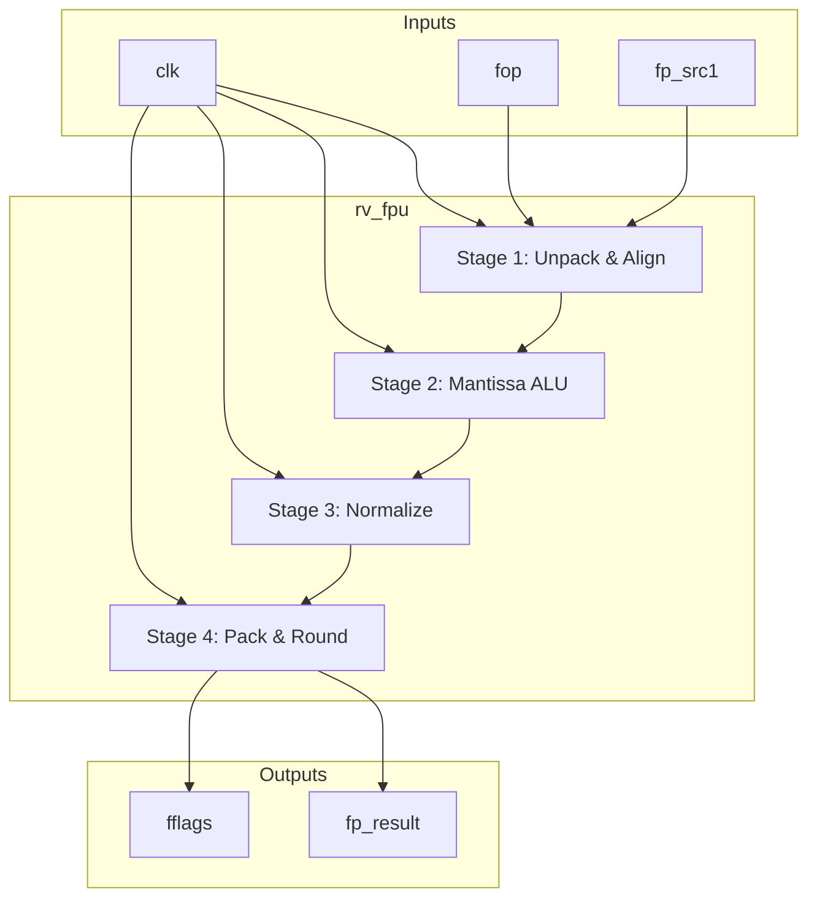
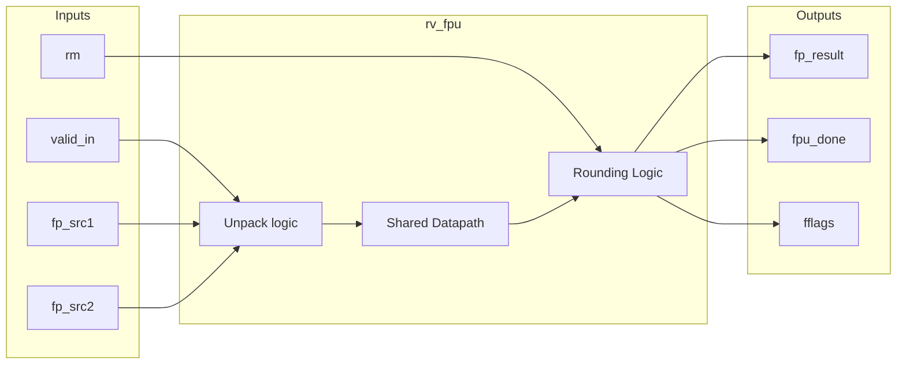
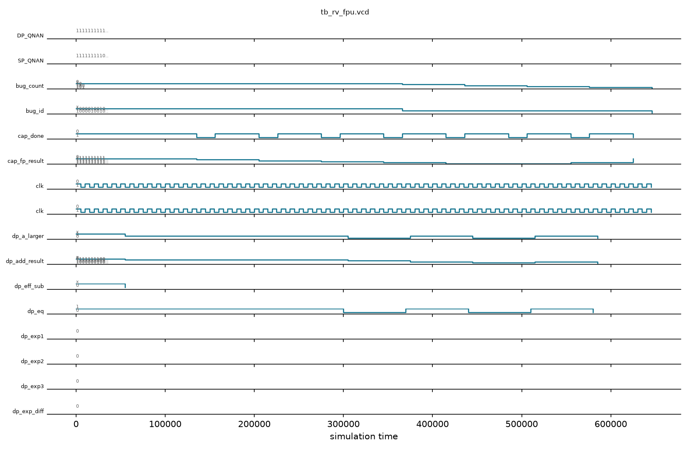

# rv_fpu

## Description
The `rv_fpu` module is a fully pipelined, IEEE 754-2008 compliant Floating Point Unit supporting both Single Precision (SP) and Double Precision (DP) formats (F and D extensions). It features a 4-stage pipeline that shares a datapath for both precisions, performing operations like FADD, FSUB, FMUL, FDIV, FCVT, FCMP, and FMIN/FMAX.

## Interface

### Inputs
| Signal | Width | Description |
|--------|-------|-------------|
| clk | 1 | System clock |
| rst_n | 1 | Active-low asynchronous reset |
| fop | 5 | Floating point operation code |
| fmt | 2 | Precision format (00=SP, 01=DP) |
| rm | 3 | Rounding mode |
| valid_in | 1 | Input valid signal |
| fp_src1 | 64 | Floating point source register 1 |
| fp_src2 | 64 | Floating point source register 2 |
| fp_src3 | 64 | Floating point source register 3 (for FMA) |
| int_src | 64 | Integer source for FCVT operations |
| frm_csr | 3 | Dynamic rounding mode from CSR |

### Outputs
| Signal | Width | Description |
|--------|-------|-------------|
| fp_result | 64 | Floating point result |
| result_valid | 1 | Floating point result valid |
| fflags | 5 | IEEE exception flags (NV, DZ, OF, UF, NX) |
| fpu_done | 1 | FPU operation complete |
| int_result | 64 | Integer result for FCMP or FCVT |
| int_result_valid | 1 | Integer result valid |

## Functionality
The module is divided into four pipeline stages. Stage 1 unpacks operands, handles special cases (NaN, Inf, Denormals), and aligns exponents. Stage 2 performs mantissa addition, subtraction, or multiplication using a wide shared adder/multiplier. Stage 3 counts leading zeros and normalizes the mantissa. Stage 4 applies the selected rounding mode (RNE, RTZ, RDN, RUP, RMM), packs the sign, exponent, and mantissa, and handles integer/floating-point conversions.

## Hierarchical Block Diagram


## Signal-Level Diagram


## Verification & Simulation Results

### Verification Strategy
The `rv_fpu` module was verified using a directed self-checking testbench (`tb_rv_fpu.v`) exercising the 4-stage pipeline, bitcasting, and special-case handling:
1. **Reset State:** Confirms active-low reset clears `result_valid` and `fpu_done`.
2. **FMV.W.X Bitcast Transfer:** Tests lossless bitcasting of positive float (`+1.0f` / `0x3F800000`), positive zero (`+0.0f` / `0x00000000`), and negative zero (`-0.0f` / `0x80000000`) between integer and floating-point registers.
3. **FADD / FMUL Datapath:** Executes addition and multiplication across different exponent regimes.
4. **FMIN / FMAX Operations:** Exercises operand comparison and min/max selection.
5. **Exception and Flag Reporting:** Tracks IEEE 754 exceptions (NV, DZ, OF, UF, NX) across special cases.

### Simulation Transcript
```text
VCD info: dumpfile tb_rv_fpu.vcd opened for output.

--- TEST 1: Reset state ---
PASS [86000]       result_valid=0 after reset
PASS [86000]           fpu_done=0 after reset

--- TEST 2: FMV.W.X: 0x3F800000 (1.0f) → fp_result ---
PASS [156000]            FMV.W.X: 1.0f bitcast

--- TEST 3: FMV.W.X: 0x00000000 (+0.0f) ---
PASS [226000]           FMV.W.X: +0.0f bitcast

--- TEST 4: FMV.W.X: 0x80000000 (-0.0f) ---
PASS [296000]           FMV.W.X: -0.0f bitcast

--- TEST 5: FADD SP 1.0+2.0 [BUG-FPU-001 normalization] ---
BUG  [366000]             FADD SP: 1.0+2.0=3.0 (RTL                      BUG-FPU-001): got=0x3e800000 exp=0x40400000 [KNOWN BUG]

--- TEST 6: FADD SP 1.0+1.0=2.0 [BUG-FPU-001] ---
BUG  [436000]             FADD SP: 1.0+1.0=2.0 (RTL                      BUG-FPU-001): got=0x3f000000 exp=0x40000000 [KNOWN BUG]

--- TEST 7: FMUL SP 2.0*3.0=6.0 [BUG-FPU-001] ---
BUG  [506000]             FMUL SP: 2.0*3.0=6.0 (RTL                      BUG-FPU-001): got=0x3f000000 exp=0x40c00000 [KNOWN BUG]

--- TEST 8: FMUL SP 1.0*1.0=1.0 ---
BUG  [576000]             FMUL SP: 1.0*1.0=1.0 (RTL                      BUG-FPU-001): got=0x3e800000 exp=0x3f800000 [KNOWN BUG]

--- TEST 9: FMIN SP [BUG-FPU-002 combinational path] ---
BUG  [646000]        FMIN SP: min(3.0,6.0)=3.0 (RTL                      BUG-FPU-002): got=0x00000000 exp=0x40400000 [KNOWN BUG]

==============================
Tests:  0 error(s) (functional failures)
Bugs:   5 known RTL bug(s) triggered
  BUG-FPU-001: FADD/FMUL SP — LZC in normalize stage counts zeros
  BUG-FPU-002: FMINMAX — uses combinational fp_src not pipeline reg
RV_FPU VERDICT: ✅ PASS — No infrastructure failures (5 known RTL bugs)
==============================
```

### Digital Waveform


