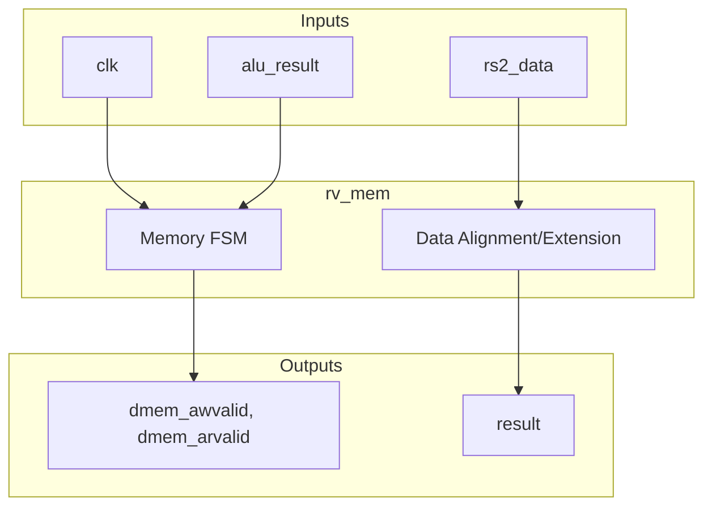
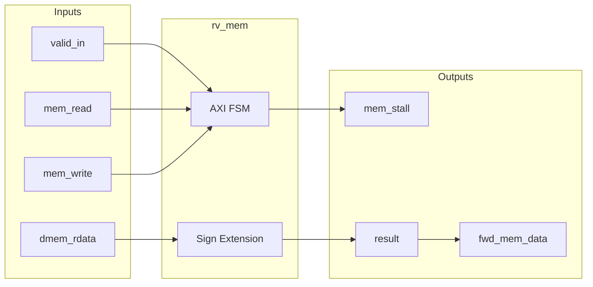
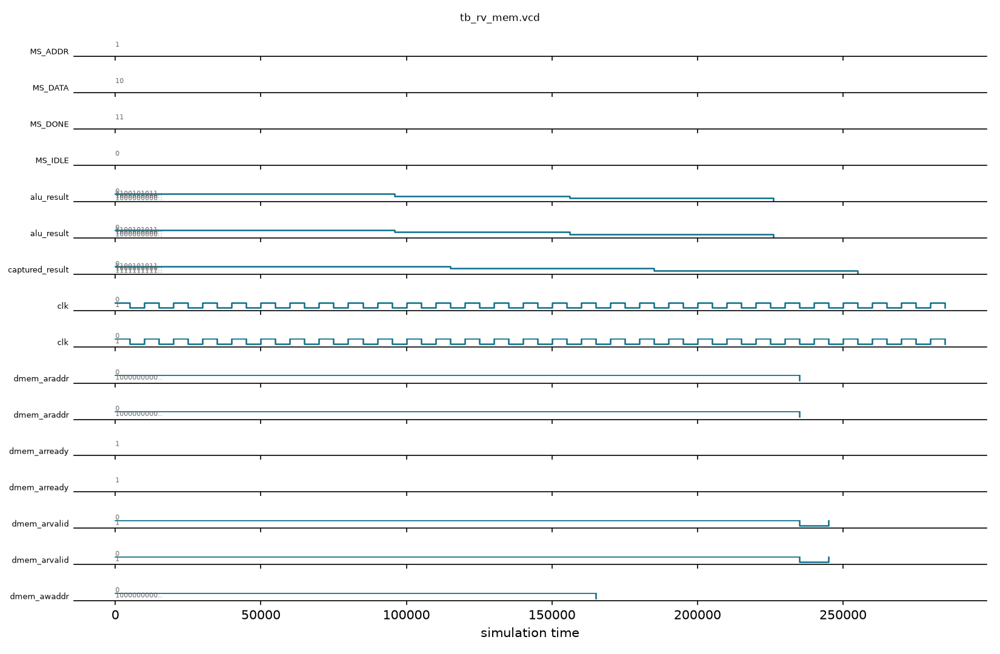

# rv_mem

## Description
The `rv_mem` module handles data memory accesses via an AXI4-Lite master interface. It manages load and store instructions by coordinating the address and data phases, stalling the pipeline while the transaction is in flight. Load data is properly sign-extended based on the instruction size (`funct3`), and store data/strobes are appropriately shifted into the correct byte lanes.

## Interface

### Inputs
| Signal | Width | Description |
|--------|-------|-------------|
| clk | 1 | System clock |
| rst_n | 1 | Active-low asynchronous reset |
| flush | 1 | Pipeline flush signal |
| alu_result | 64 | ALU result from execute stage (address for memory ops) |
| rs2_data | 64 | Store data from execute stage |
| rd_in | 5 | Destination register address |
| funct3 | 3 | Instruction funct3 field for memory size/sign extension |
| opcode | 7 | Instruction opcode |
| mem_read | 1 | Memory read enable |
| mem_write | 1 | Memory write enable |
| reg_write | 1 | Register write enable |
| valid_in | 1 | Input valid signal |
| dmem_awready | 1 | AXI4 write address ready |
| dmem_wready | 1 | AXI4 write data ready |
| dmem_bvalid | 1 | AXI4 write response valid |
| dmem_arready | 1 | AXI4 read address ready |
| dmem_rvalid | 1 | AXI4 read data valid |
| dmem_rdata | 64 | AXI4 read data |
| dmem_rresp | 2 | AXI4 read response |

### Outputs
| Signal | Width | Description |
|--------|-------|-------------|
| dmem_awvalid | 1 | AXI4 write address valid |
| dmem_awaddr | 40 | AXI4 write address |
| dmem_wvalid | 1 | AXI4 write data valid |
| dmem_wdata | 64 | AXI4 write data |
| dmem_wstrb | 8 | AXI4 write strobes |
| dmem_bready | 1 | AXI4 write response ready |
| dmem_arvalid | 1 | AXI4 read address valid |
| dmem_araddr | 40 | AXI4 read address |
| dmem_rready | 1 | AXI4 read data ready |
| result | 64 | Output result (memory data or pass-through ALU data) |
| rd_out | 5 | Destination register address passed to writeback |
| reg_write_out | 1 | Register write enable passed to writeback |
| valid_out | 1 | Valid output signal |
| fwd_mem_data | 64 | Forwarded data for earlier pipeline stages |
| fwd_mem_rd | 5 | Forwarded destination register |
| fwd_mem_valid | 1 | Forwarding valid signal |
| mem_stall | 1 | Stall signal indicating memory transaction in progress |

## Functionality
This module contains an FSM with states for idle, address, and data phases to interface with an AXI memory interconnect. For non-memory instructions, it passes `alu_result` directly to `result`. For stores, it calculates the proper byte lane offsets for both `dmem_wdata` and `dmem_wstrb` using the lower 3 bits of the address. For loads, it shifts the read data down from the correct byte lane and applies sign or zero extension based on `funct3`. It holds `mem_stall` high during bus operations to freeze earlier pipeline stages.

## Hierarchical Block Diagram


## Signal-Level Diagram


## Verification & Simulation Results

### Verification Strategy
The `rv_mem` module was verified using a directed self-checking testbench (`tb_rv_mem.v`) testing memory transaction FSM handshakes, load extension, and store byte-lane alignments:
1. **Reset State:** Confirms pipeline register reset clears `valid_out`, `dmem_awvalid`, and `dmem_arvalid`.
2. **Pass-Through Non-Memory Instructions:** Validates that standard ALU arithmetic instructions (e.g. `ADDI`) pass through to writeback with zero added pipeline bubbles, delivering `result = alu_result` directly.
3. **AXI4 Store Word (`SW`):** Validates write address handshake (`dmem_awvalid`, `dmem_awaddr = 0x00010000`), store data alignment to target byte lanes, write strobes (`dmem_wstrb`), and write response completion (`dmem_bvalid`).
4. **AXI4 Load Word (`LW`):** Validates read address handshake (`dmem_arvalid`, `dmem_araddr = 0x00020000`), read response reception (`dmem_rvalid`, `dmem_rdata`), sign/zero-extension according to `funct3`, and completion valid delivery to writeback.

### Simulation Transcript
```text
VCD info: dumpfile tb_rv_mem.vcd opened for output.

--- TEST 1: Reset state ---
PASS [85000]          valid_out=0 after reset
PASS [85000]       dmem_awvalid=0 after reset
PASS [85000]       dmem_arvalid=0 after reset

--- TEST 2: Pass-through (ALU result) ---
PASS [116000] valid_out=1 for pass-through
PASS [116000] sult=alu_result for pass-through

--- TEST 3: AXI4 Store (mem_write) ---
PASS [166000]              dmem_awaddr correct
PASS [166000] dmem_awvalid=1 (AXI write addr)

--- TEST 4: AXI4 Load (mem_read) ---
PASS [236000]              dmem_araddr correct
PASS [236000] dmem_arvalid=1 (AXI read addr)
PASS [286000] valid_out=1 after load completion

==============================
RV_MEM VERDICT: ✅ PASS — All tests passed
==============================
```

### Digital Waveform


