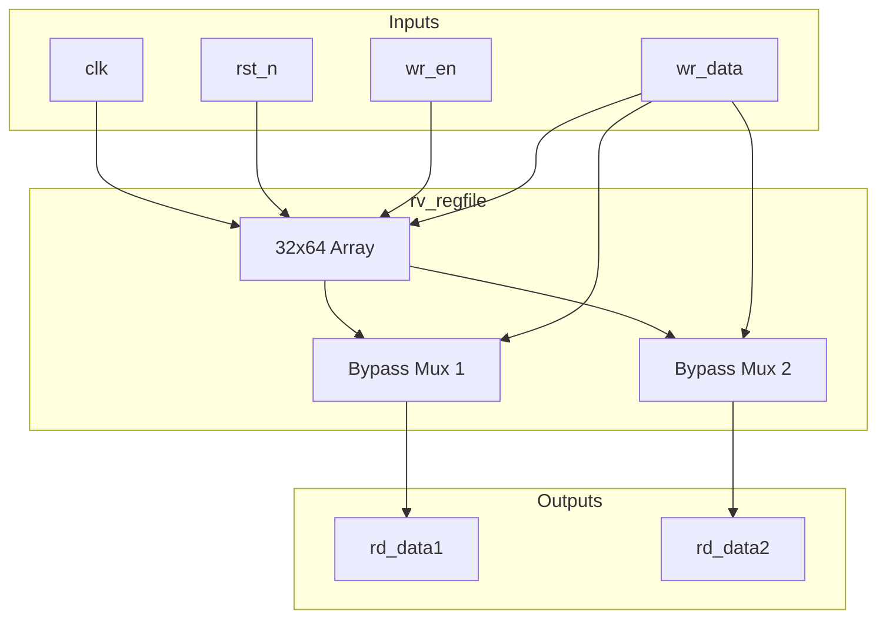
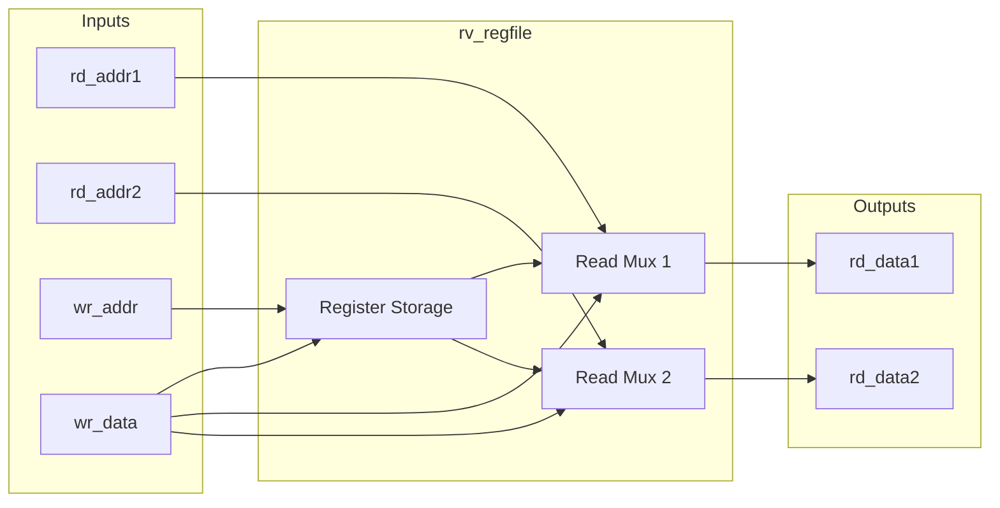
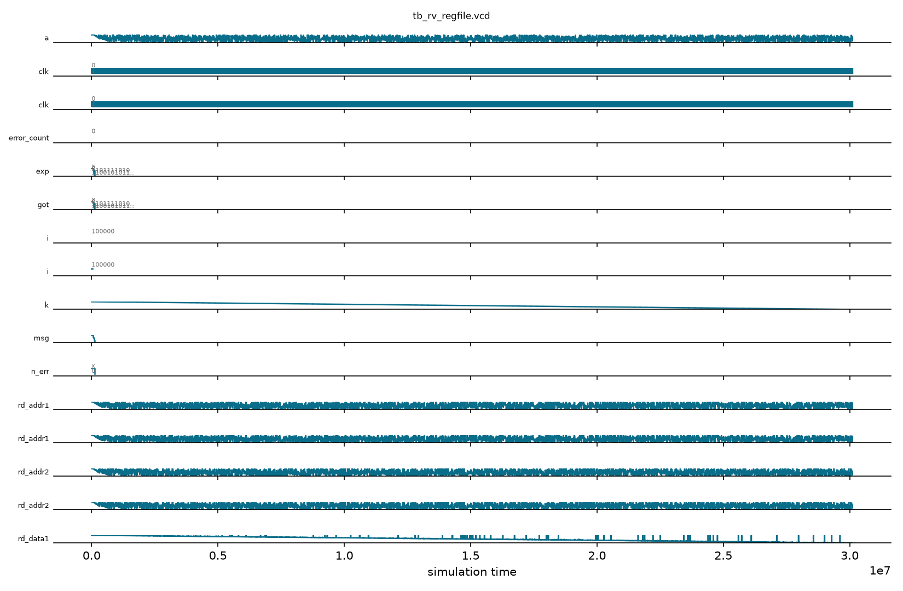

# rv_regfile

## Description
The `rv_regfile` module is a 32x64-bit general-purpose integer register file for the RV64 architecture. It provides two asynchronous read ports for fetching source operands in the decode stage and one synchronous write port for the writeback stage. It includes an internal write-first bypass to handle structural hazards where an instruction reads a register in the same cycle it is being written.

## Interface

### Inputs
| Signal | Width | Description |
|--------|-------|-------------|
| clk | 1 | System clock |
| rst_n | 1 | Active-low asynchronous reset |
| rd_addr1 | 5 | Read port 1 address |
| rd_addr2 | 5 | Read port 2 address |
| wr_en | 1 | Write enable |
| wr_addr | 5 | Write address |
| wr_data | 64 | Write data |

### Outputs
| Signal | Width | Description |
|--------|-------|-------------|
| rd_data1 | 64 | Read port 1 data |
| rd_data2 | 64 | Read port 2 data |

## Functionality
The register file instantiates a 32-entry array of 64-bit registers. Register `x0` is hardwired to zero; writes to it are ignored, and reads always return 0. The read ports are combinational. To support write-before-read forwarding, a multiplexer checks if the write address matches the read address while `wr_en` is high. If so, it forwards `wr_data` directly to the output instead of reading the stale value from the memory array.

## Hierarchical Block Diagram


## Signal-Level Diagram


## Verification & Simulation Results

### Verification Strategy
The `rv_regfile` module was verified using a comprehensive self-checking testbench (`tb_rv_regfile.v`) combining targeted boundary tests and a 3,000-cycle randomized golden shadow model comparison:
1. **Reset State:** Validates that active-low reset initializes all 32 64-bit registers to zero.
2. **Dual-Port Asynchronous Read:** Confirms independent, simultaneous reading of different registers on `rd_addr1` and `rd_addr2` without crosstalk.
3. **Hardwired Constant Zero (`x0`):** Confirms that write attempts with all-ones (`0xFFFFFFFFFFFFFFFF`) to `wr_addr = 5'h0` are safely dropped, and `x0` reads zero on both ports.
4. **Internal Write-First Bypass:** Verifies that a read to a register being written in the same clock cycle immediately forwards the incoming write data mid-cycle.
5. **No Cross-Register Leakage:** Verifies that bypassing on one register does not affect reads of other registers.
6. **3000-Cycle Randomized Stress vs. Shadow Model:** Validates 3000 randomized operations against an architectural golden shadow model with ~75% write probability and random read/write addresses.

### Simulation Transcript
```text
VCD info: dumpfile tb_rv_regfile.vcd opened for output.

--- TEST 1: Reset state ---
PASS [55000]     port1 x0 reads 0 after reset
PASS [56000]    port1 x17 reads 0 after reset
PASS [56000]    port2 x31 reads 0 after reset

--- TEST 2: Write/readback ---
PASS [77000]             port1 reads back x17
PASS [77000]             port2 reads back x17

--- TEST 3: x0 hardwired ---
PASS [97000]     write to x0 ignored, reads 0

--- TEST 4: Write-first bypass ---
PASS [107000]        port1 bypass during write
PASS [107000]        port2 bypass during write
PASS [107000]     model agrees on bypass value
PASS [116000]       value committed after edge

--- TEST 5: No cross-register bypass ---
PASS [117000]       x10 unaffected by x9 write

--- TEST 6: Randomized vs shadow model ---
PASS [30115000] 3000 randomized cycles match shadow model

==============================
RV_REGFILE VERDICT: ✅ PASS — All tests passed
==============================
```

### Digital Waveform


