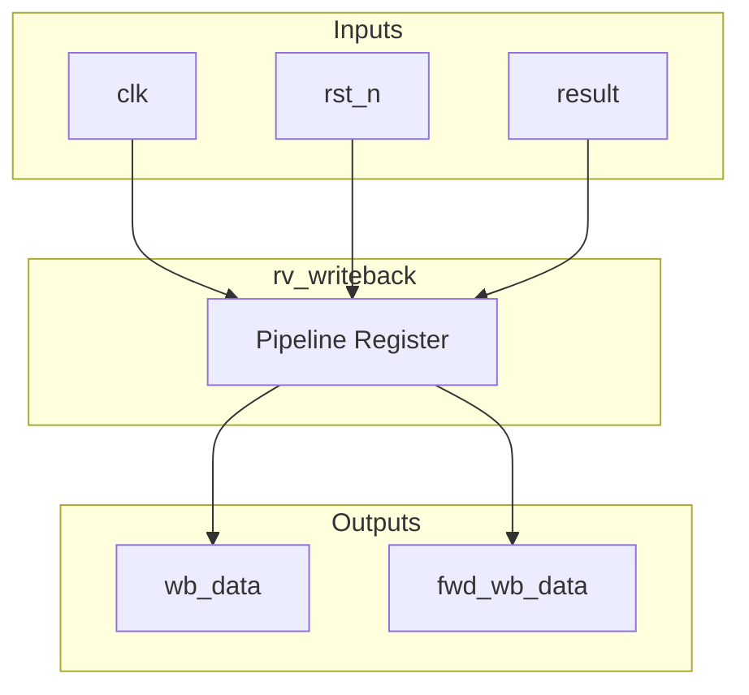
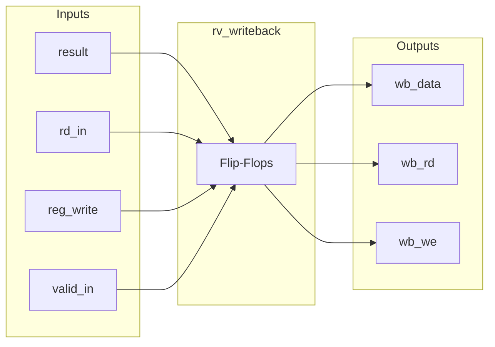
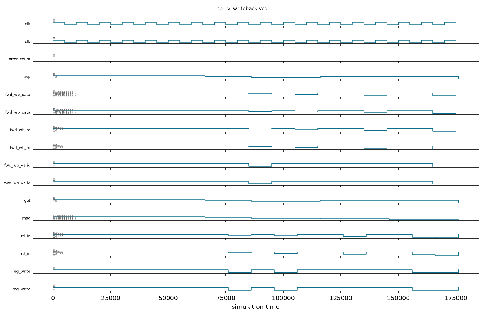

# rv_writeback

## Description
The `rv_writeback` module is the final stage of the pipeline. It simply registers the incoming result from the memory stage and drives the write port of the register file (located in the decode stage). It also provides a forwarding path back to the execute stage to resolve distance-2 data hazards.

## Interface

### Inputs
| Signal | Width | Description |
|--------|-------|-------------|
| clk | 1 | System clock |
| rst_n | 1 | Active-low asynchronous reset |
| result | 64 | Result data from memory stage |
| rd_in | 5 | Destination register address |
| reg_write | 1 | Register write enable |
| valid_in | 1 | Input valid signal |

### Outputs
| Signal | Width | Description |
|--------|-------|-------------|
| wb_data | 64 | Data to be written to the register file |
| wb_rd | 5 | Destination register address for the register file |
| wb_we | 1 | Write enable for the register file (forces 0 for x0) |
| fwd_wb_data | 64 | Forwarded data for earlier pipeline stages |
| fwd_wb_rd | 5 | Forwarded destination register |
| fwd_wb_valid | 1 | Forwarding valid signal |

## Functionality
This module captures the execution result and destination information into pipeline registers on the clock edge. It outputs these registered values as write signals to the integer register file. A check is included to disable writes to register `x0`. The same outputs are exposed combinationally as forwarding paths (`fwd_wb_*`) to provide the freshest data to dependent instructions in the execute stage before they are formally written to the register file.

## Hierarchical Block Diagram


## Signal-Level Diagram


## Verification & Simulation Results

### Verification Strategy
The `rv_writeback` module was verified using a directed self-checking testbench (`tb_rv_writeback.v`) checking pipeline register latching, forwarding generation, and zero-register write filtering:
1. **Reset State:** Confirms active-low reset clears writeback write enable (`wb_we = 0`) and forwarding valid (`fwd_wb_valid = 0`).
2. **Standard Write-Back Operation:** Exercises valid retirement with `rd_in = 5`, `result = 0xDEADBEEF12345678`, `reg_write = 1`, and `valid_in = 1`, verifying 1-cycle registered write output to decode regfile.
3. **Forwarding Signal Generation:** Verifies combinational export of `fwd_wb_data`, `fwd_wb_rd`, and `fwd_wb_valid` concurrently with register writeback.
4. **Invalid Transaction Protection:** Confirms that `valid_in = 0` suppresses `wb_we` even if `reg_write = 1`.
5. **Non-Register Instruction Filtering:** Confirms that `reg_write = 0` suppresses `wb_we` even if `valid_in = 1`.
6. **Consecutive Back-to-Back Writebacks:** Verifies seamless back-to-back retirement of multiple instructions across consecutive clock cycles.

### Simulation Transcript
```text
VCD info: dumpfile tb_rv_writeback.vcd opened for output.

--- TEST 1: Reset state ---
PASS [66000]              wb_we=0 after reset
PASS [66000]       fwd_wb_valid=0 after reset

--- TEST 2: Write-back rd=5, data=0xDEADBEEF12345678 ---
PASS [86000]       wb_data=0xDEADBEEF12345678
PASS [86000]                          wb_rd=5
PASS [86000]      wb_we=1 for valid reg_write

--- TEST 3: Forwarding signals ---
PASS [86000]            fwd_wb_data = wb_data
PASS [86000]                fwd_wb_rd = wb_rd
PASS [86000]             fwd_wb_valid = wb_we

--- TEST 4: valid_in=0, no WB ---
PASS [116000]          wb_we=0 when valid_in=0

--- TEST 5: reg_write=0, no WB ---
PASS [146000]         wb_we=0 when reg_write=0

--- TEST 6: Consecutive write-backs ---
PASS [176000]    wb_data=0xBBBB... (second WB)
PASS [176000]              wb_rd=2 (second WB)

==============================
RV_WRITEBACK VERDICT: ✅ PASS — All tests passed
==============================
```

### Digital Waveform


