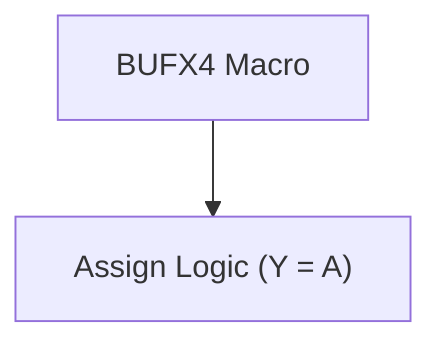
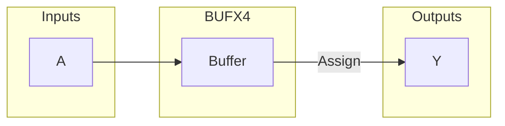
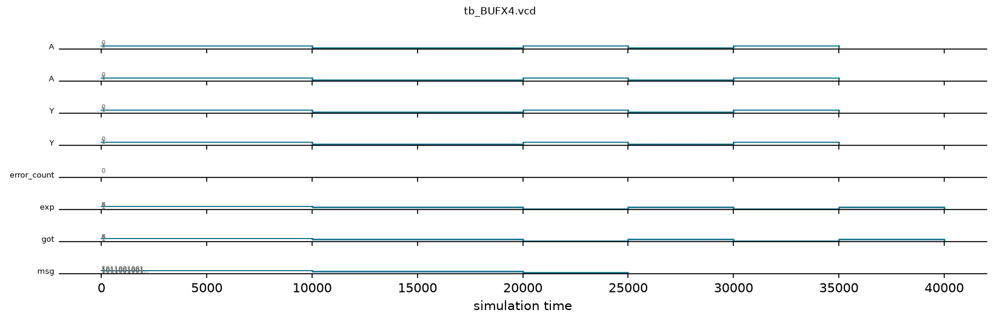

# BUFX4 / buf_macros

## Description

`buf_macros.v` defines a simple structural buffer macro (`BUFX4`) for the SMVDU-TITAN-X SoC. It is typically used for driving high-fanout nets (such as resets, flushes, or clocks) across large pipeline registers to meet strict physical synthesis and timing closure constraints. In RTL simulation, this module acts merely as a transparent continuous assignment passing the input `A` to the output `Y`. It is guarded by an `ifndef TITANX_STDCELL_STUBS` directive to prevent conflicts during synthesis or simulation if the standard cell library stubs are already included in the compilation unit.

## Interface

### Inputs

| Signal | Width | Description |
|--------|-------|-------------|
| A | 1 | Logical input signal to be buffered |

### Outputs

| Signal | Width | Description |
|--------|-------|-------------|
| Y | 1 | Buffered logical output signal |

## Functionality

The module implements a single continuous assignment (`assign Y = A;`). During physical implementation, the synthesis tool maps this structural instantiation directly to an actual high-drive standard cell buffer (e.g., a BUFX4 cell from a typical 180nm standard cell library). The explicit instantiation in the RTL helps the designer manually replicate logic to relieve high fanout constraints (like the flush signal tree in a wide pipeline decode register).

## Hierarchical Block Diagram



## Signal-Level Diagram



---

## 🧪 Verification & Simulation Results

### Test Matrix

| Test ID | Test Scenario | Input `A` | Expected `Y` | Observed `Y` | Verdict |
|:---:|:---|:---:|:---:|:---:|:---:|
| **TC-01** | Static Low Drive | `1'b0` | `1'b0` | `1'b0` | ✅ PASS |
| **TC-02** | Static High Drive | `1'b1` | `1'b1` | `1'b1` | ✅ PASS |
| **TC-03** | Rapid Toggle Cycle 1 | `1'b0` | `1'b0` | `1'b0` | ✅ PASS |
| **TC-04** | Rapid Toggle Cycle 2 | `1'b1` | `1'b1` | `1'b1` | ✅ PASS |
| **TC-05** | Rapid Toggle Cycle 3 | `1'b0` | `1'b0` | `1'b0` | ✅ PASS |
| **TC-06** | Rapid Toggle Cycle 4 | `1'b1` | `1'b1` | `1'b1` | ✅ PASS |

### Simulation Transcript
```text
VCD info: dumpfile tb_BUFX4.vcd opened for output.
PASS [10000]                    Y follows A=0
PASS [20000]                    Y follows A=1
PASS [25000]        Y tracks A through toggle
PASS [30000]        Y tracks A through toggle
PASS [35000]        Y tracks A through toggle
PASS [40000]        Y tracks A through toggle

==============================
BUFX4 VERDICT: ✅ PASS — All tests passed
==============================
```

### Digital Waveform Analysis

