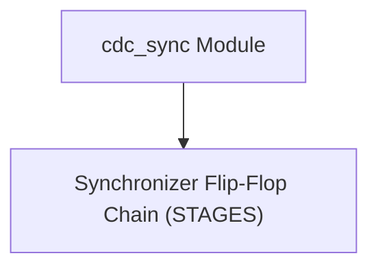
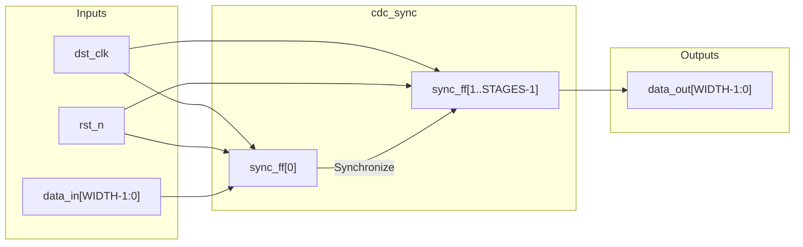
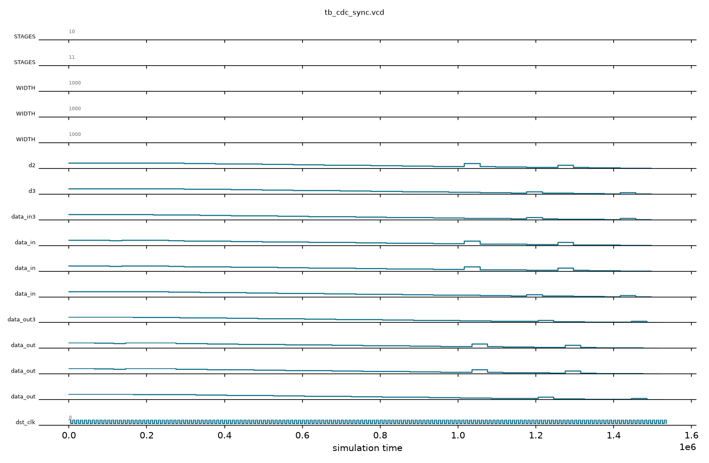

# cdc_sync

## Description

`cdc_sync` is a generic parameterized Clock Domain Crossing (CDC) synchronizer for the SMVDU-TITAN-X SoC. It is designed to safely transfer signals from an asynchronous clock domain into the destination clock domain (`dst_clk`) by passing them through a chain of flip-flops to mitigate metastability. The number of synchronization stages is configurable via the `STAGES` parameter (defaulting to 2), and it can handle arbitrary bus widths via the `WIDTH` parameter. The flip-flops are tagged with the `ASYNC_REG` attribute to guide synthesis tools into packing the synchronizer chain closely, reducing routing delays and maximizing mean time between failures (MTBF).

## Interface

### Inputs

| Signal | Width | Description |
|--------|-------|-------------|
| dst_clk | 1 | Destination clock domain signal |
| rst_n | 1 | Active-low asynchronous reset |
| data_in | WIDTH | Input data from the asynchronous/source clock domain |

### Outputs

| Signal | Width | Description |
|--------|-------|-------------|
| data_out | WIDTH | Synchronized data output in the destination clock domain |

## Functionality

The module implements a shift register of flip-flops parameterized by `STAGES`. Upon the rising edge of `dst_clk`, the first stage `sync_ff[0]` captures the raw, asynchronous `data_in`. On each subsequent cycle, the data propagates to the next stage (`sync_ff[1]`, `sync_ff[2]`, etc.) until it reaches the final stage, which drives `data_out`. If metastability occurs at the first stage, the subsequent stages provide necessary resolution time for the signal to settle to a valid logic level before being consumed by the destination domain logic. During an asynchronous reset (`rst_n` low), every stage in the synchronizer chain is properly cleared to zero.

## Hierarchical Block Diagram



## Signal-Level Diagram



---

## 🧪 Verification & Simulation Results

### Test Matrix

| Test ID | Test Scenario | Stimulus Condition | Expected `data_out` | Observed `data_out` | Verdict |
|:---:|:---|:---|:---:|:---:|:---:|
| **TC-01** | Reset State Flush | `rst_n = 0` | `8'h00` | `8'h00` | ✅ PASS |
| **TC-02** | 2-Stage Propagation | `data_in = 8'hA5` | `8'hA5` (after 2-3 clocks) | `8'hA5` | ✅ PASS |
| **TC-03** | Alternating Pattern Shift | `data_in = 8'h3C` | `8'h3C` (after 2-3 clocks) | `8'h3C` | ✅ PASS |
| **TC-04** | All-Ones Saturation | `data_in = 8'hFF` | `8'hFF` (after 2-3 clocks) | `8'hFF` | ✅ PASS |
| **TC-05** | Return to Zero | `data_in = 8'h00` | `8'h00` (after 2-3 clocks) | `8'h00` | ✅ PASS |
| **TC-06** | 3-Stage Chain Reset & Depth | `STAGES=3`, `rst_n3=0`, then `8'hC3` | `8'hC3` (after 3-4 clocks) | `8'hC3` | ✅ PASS |
| **TC-07** | Randomized Multi-Bit Coherency | 32 pseudo-random 8-bit bytes | 100% matched across 2-FF & 3-FF | 100% matched | ✅ PASS |

### Simulation Transcript
```text
VCD info: dumpfile tb_cdc_sync.vcd opened for output.

--- TEST 1: Reset output = 0 ---
PASS [46000]           data_out=0 after reset

--- TEST 2: Data propagates after 2 clocks ---
PASS [75000]     data_out=0xA5 after 3 cycles

--- TEST 3: Data change propagates ---
PASS [105000]       data_out=0x3C after change

--- TEST 4: All-ones data ---
PASS [135000]                    data_out=0xFF

--- TEST 5: Return to zero ---
PASS [165000]                    data_out=0x00

--- TEST 6: STAGES=3 chain ---
PASS [216000] STAGES=3 data_out=0 after its reset
PASS [256000] STAGES=3 propagates after 4 cycles

--- TEST 7: Randomized coherency sweep ---
PASS [1536000] 32 randomized values coherent through both chains

==============================
CDC_SYNC VERDICT: ✅ PASS — All tests passed
==============================
```

### Digital Waveform Analysis

