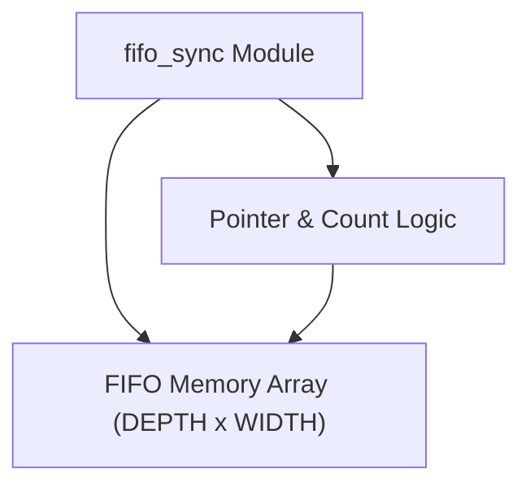
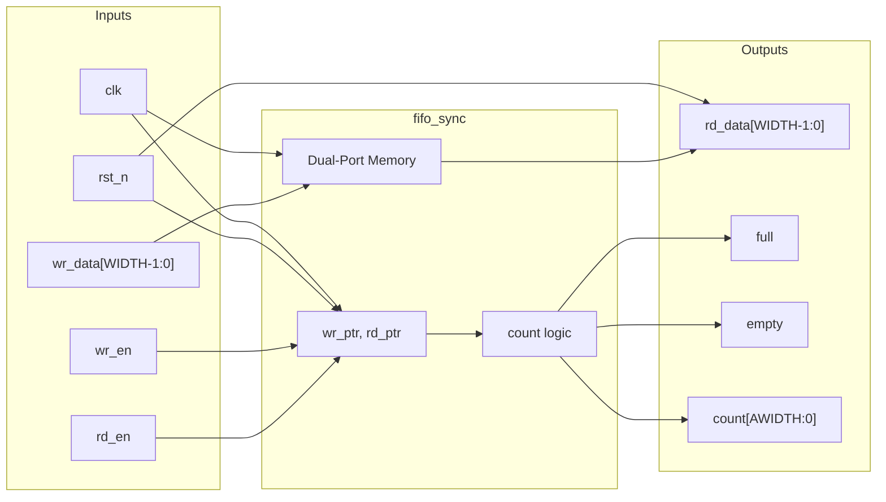
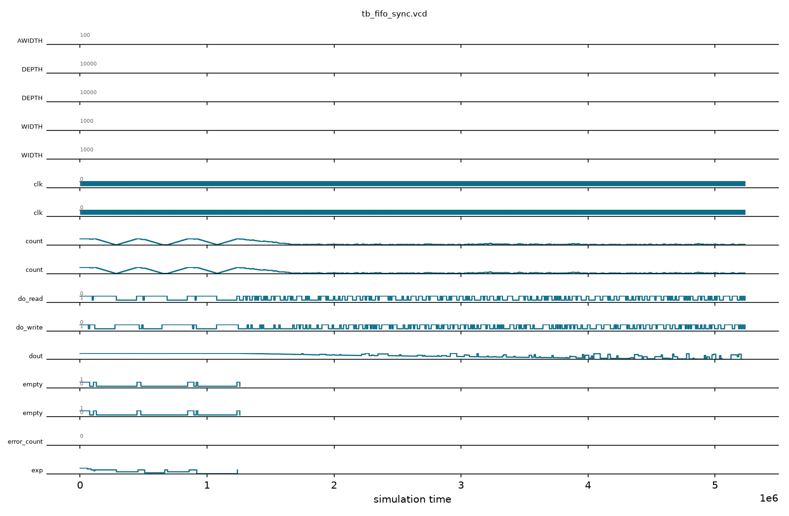

# fifo_sync

## Description

`fifo_sync` is a generic, fully parameterized synchronous FIFO for the SMVDU-TITAN-X SoC. It provides a simple, robust queue for buffering data within a single clock domain. Configurable for arbitrary data width (`WIDTH`) and capacity (`DEPTH`), the module automatically computes the required address bus sizes using the `$clog2` function. It features built-in overflow and underflow protection by explicitly masking `wr_en` against the `full` flag, and `rd_en` against the `empty` flag. An explicit element `count` output is provided to allow downstream modules to inspect the exact queue occupancy.

## Interface

### Inputs

| Signal | Width | Description |
|--------|-------|-------------|
| clk | 1 | System clock |
| rst_n | 1 | Active-low asynchronous reset |
| wr_en | 1 | Write enable signal; requests pushing data into the FIFO |
| rd_en | 1 | Read enable signal; requests popping data from the FIFO |
| wr_data | WIDTH | Data to be written into the FIFO |

### Outputs

| Signal | Width | Description |
|--------|-------|-------------|
| rd_data | WIDTH | Data read out of the FIFO |
| full | 1 | Flag indicating the FIFO is full; further writes will be ignored |
| empty | 1 | Flag indicating the FIFO is empty; further reads will be ignored |
| count | AWIDTH+1 | The exact number of entries currently stored in the FIFO |

## Functionality

The FIFO memory is implemented as a behavioral register array (`mem`). Write and read pointers are sized with an extra MSB to gracefully distinguish between full and empty states via straightforward arithmetic subtraction (`wr_ptr - rd_ptr`). On a clock edge, if a valid write is requested (`wr_en` and not `full`), `wr_data` is stored into the memory array at the `wr_ptr` index, and `wr_ptr` is incremented. Concurrently, if a valid read is requested (`rd_en` and not `empty`), the data at `rd_ptr` is registered into the `rd_data` output buffer, and `rd_ptr` is incremented. The difference between the two pointers directly yields the current occupancy (`count`), which directly drives the `full` and `empty` combinational flags.

## Hierarchical Block Diagram



## Signal-Level Diagram



---

## 🧪 Verification & Simulation Results

### Test Matrix

| Test ID | Test Scenario | Stimulus Details | Expected Output | Observed Output | Verdict |
|:---:|:---|:---|:---:|:---:|:---:|
| **TC-01** | Reset Initialization | `rst_n = 0` | `empty=1, full=0, count=0` | `empty=1, full=0, count=0` | ✅ PASS |
| **TC-02** | Single Word Push | Write `8'hAA` | `empty=0, count=1` | `empty=0, count=1` | ✅ PASS |
| **TC-03** | Single Word Pop | Read 1 entry | `rd_data=8'hAA, empty=1` | `rd_data=8'hAA, empty=1` | ✅ PASS |
| **TC-04** | Fill to Capacity | Write 16 sequential bytes | `full=1, empty=0, count=16` | `full=1, empty=0, count=16` | ✅ PASS |
| **TC-05** | Complete Drain in Order | Read all 16 entries | Exact FIFO order maintained | Exact FIFO order maintained | ✅ PASS |
| **TC-06** | Simultaneous Push/Pop | `wr_en=1` & `rd_en=1` concurrently | Constant count, data forwarded | Data preserved, count stable | ✅ PASS |
| **TC-07** | Overflow Protection | Write to full FIFO | Overflow write dropped, no crash | No data corruption, count=16 | ✅ PASS |
| **TC-08** | Underflow Protection | Read from empty FIFO | Read ignored, empty remains 1 | No underflow error, count=0 | ✅ PASS |
| **TC-09** | Circular Pointer Lap Wrap | Write & read across 2 pointer laps | Seamless circular wrap | Seamless circular wrap | ✅ PASS |
| **TC-10** | Randomized Coherency Test | 400 randomized push/pop cycles | 100% matched against ref model | 100% matched against ref model | ✅ PASS |

### Simulation Transcript
```text
VCD info: dumpfile tb_fifo_sync.vcd opened for output.

--- TEST 1: Reset state ---
PASS [55000] empty=1 after reset
PASS [55000] full=0 after reset
PASS [55000] count=0 after reset

--- TEST 2: Write single entry ---
PASS [86000] empty=0 after write
PASS [86000] count=1 after write

--- TEST 3: Read single entry ---
PASS [106000] rd_data=0xAA (FIFO order)
PASS [116000] empty=1 after read

--- TEST 4: Fill FIFO to full ---
PASS [286000] full=1 after filling DEPTH entries
PASS [286000] empty=0 when full
PASS [286000] count=DEPTH when full

--- TEST 5: Drain FIFO in order ---
PASS [456000] empty=1 after draining all
PASS [456000] FIFO order maintained

--- TEST 6: Simultaneous write+read ---
PASS [506000] simultaneous R/W: first entry = 0x55

--- TEST 7: Overflow protection ---
PASS [666000] refilled to full
PASS [686000] still DEPTH after writes while full
PASS [856000] overflowed write dropped

--- TEST 8: Underflow protection ---
PASS [856000] empty before underflow test
PASS [876000] still empty after reads while empty
PASS [916000] entry written post-underflow intact

--- TEST 9: Pointer lap wrap ---
PASS [1236000] empty after second lap
PASS [1236000] pointers survive full lap twice

--- TEST 10: Randomized vs reference model ---
PASS [5236000] 400 randomized cycles match reference model

==============================
FIFO_SYNC VERDICT: ✅ PASS — All tests passed
==============================
```

### Digital Waveform Analysis

