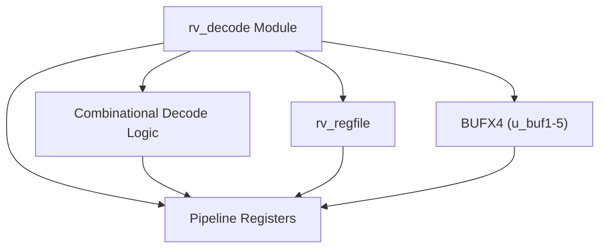
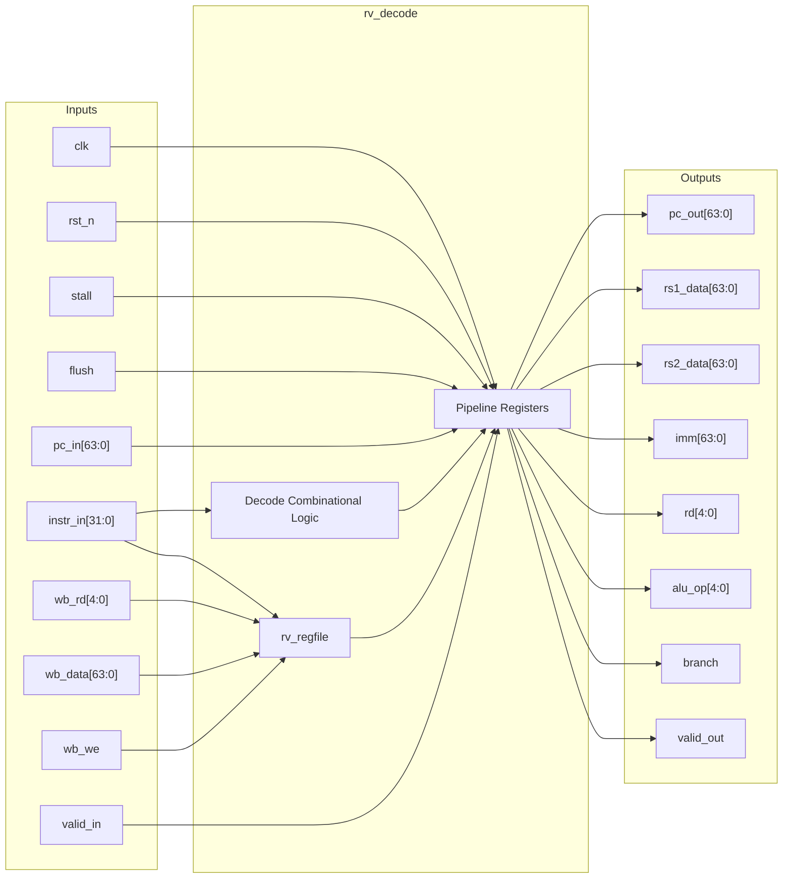
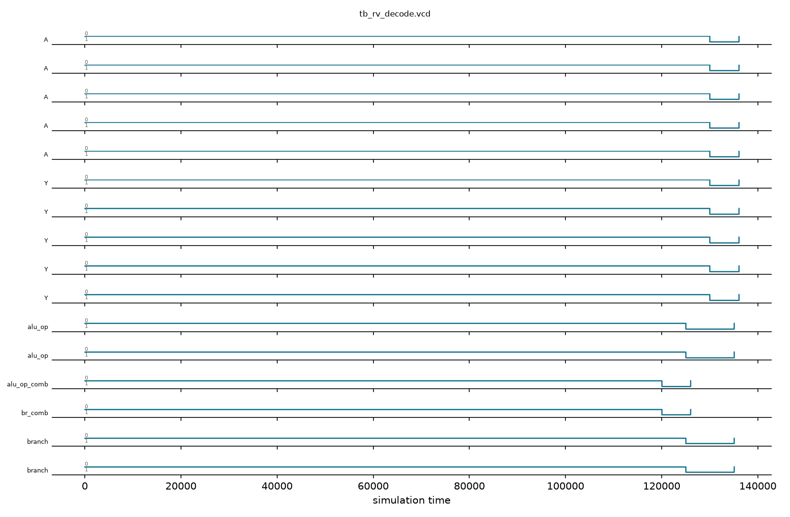

# rv_decode

## Description

`rv_decode` is the instruction decode and register file stage for the SMVDU-TITAN-X RISC-V (RV64I) SoC. It is responsible for taking fetched 32-bit instructions and decoding them into microarchitectural control signals, immediate values, and register addresses. The module instantiates the `rv_regfile` sub-module to read source register operands and supports internal forwarding from the writeback stage to resolve data hazards. Additionally, it features high-fanout buffering for the `flush` signal using `BUFX4` macros and includes full decode support for the M-extension (multiply/divide) as well as system instructions (CSR operations, `ecall`, `ebreak`, `mret`). 

## Interface

### Inputs

| Signal | Width | Description |
|--------|-------|-------------|
| clk | 1 | System clock |
| rst_n | 1 | Active-low asynchronous reset |
| stall | 1 | Pipeline stall signal to freeze the decode stage |
| flush | 1 | Pipeline flush signal to clear the decode stage |
| pc_in | 64 | Program counter value from the fetch stage |
| instr_in | 32 | Fetched instruction from the fetch stage |
| valid_in | 1 | Valid flag indicating valid input from the fetch stage |
| wb_rd | 5 | Destination register address from the writeback stage |
| wb_data | 64 | Data from the writeback stage to be written to the register file |
| wb_we | 1 | Write enable signal from the writeback stage |

### Outputs

| Signal | Width | Description |
|--------|-------|-------------|
| pc_out | 64 | Program counter value passed to the execute stage |
| rs1_data | 64 | Source register 1 data passed to the execute stage |
| rs2_data | 64 | Source register 2 data passed to the execute stage |
| imm | 64 | Sign-extended immediate value passed to the execute stage |
| rd | 5 | Destination register address passed to the execute stage |
| rs1_addr | 5 | Source register 1 address |
| rs2_addr | 5 | Source register 2 address |
| funct3 | 3 | Instruction funct3 field passed to the execute stage |
| funct7 | 7 | Instruction funct7 field passed to the execute stage |
| opcode | 7 | Instruction opcode field passed to the execute stage |
| alu_op | 5 | Decoded ALU operation code |
| mem_read | 1 | Control signal indicating a memory read operation |
| mem_write | 1 | Control signal indicating a memory write operation |
| reg_write | 1 | Control signal indicating a register file write operation |
| branch | 1 | Control signal indicating a conditional branch instruction |
| jal | 1 | Control signal indicating a JAL instruction |
| jalr | 1 | Control signal indicating a JALR instruction |
| is_csr | 1 | Control signal indicating a CSR instruction |
| csr_op | 2 | Decoded CSR operation type |
| is_ecall | 1 | Control signal indicating an ECALL instruction |
| is_ebreak | 1 | Control signal indicating an EBREAK instruction |
| is_mret | 1 | Control signal indicating an MRET instruction |
| valid_out | 1 | Valid flag indicating valid instruction delivery to execute |

## Functionality

The module combinationally extracts instruction fields (`opcode`, `funct3`, `funct7`, `rs1`, `rs2`, `rd`) and decodes them to generate control signals (e.g., `alu_op`, `mem_read`, `reg_write`, `is_csr`). It supports various instruction formats, sign-extending immediates accurately for RV64I (including correctly zero-padding upper bits for specific instructions). The `rv_regfile` sub-module is instantiated to handle register reads, while writeback bypassing ensures that if the writeback stage writes to a register currently being read, the new data is immediately forwarded. Control signals and operand data are then latched into pipeline registers. The `flush` input is buffered via `BUFX4` macros to meet timing constraints across the wide pipeline register.

## Hierarchical Block Diagram



## Signal-Level Diagram



## Verification & Simulation Results

### Verification Strategy
The `rv_decode` module was rigorously verified using a directed self-checking testbench (`tb_rv_decode.v`) with actual standard cell buffering (`BUFX4`) and physical register file (`rv_regfile`) integration:
1. **Reset State:** Confirms pipeline register reset clears `valid_out`, register addresses, and microarchitectural control signals.
2. **I-Type Arithmetic Instruction (`ADDI x1, x0, 42`):** Validates opcode decode (`0x13`), destination register (`rd = 1`), source register (`rs1 = 0`), sign-extended immediate (`imm = 42`), ALU operation (`ALU_ADD`), register write enable (`reg_write = 1`), and pipeline valid assertion (`valid_out = 1`).
3. **Load Instruction (`LW x2, 8(x1)`):** Validates opcode decode (`0x03`), memory read flag (`mem_read = 1`, `mem_write = 0`), destination register (`rd = 2`), and byte offset sign-extension.
4. **Store Instruction (`SW x2, 16(x1)`):** Validates opcode decode (`0x23`), memory write flag (`mem_write = 1`, `mem_read = 0`, `reg_write = 0`), and correct split-field S-type immediate assembly (`imm = 16`).
5. **Conditional Branch Instruction (`BEQ x0, x0, +8`):** Validates B-type instruction decoding (`opcode = 0x63`, `branch = 1`, `reg_write = 0`, `mem_read = 0`).
6. **Pipeline Flush Handling:** Injects high-fanout buffered `flush = 1` concurrently with instruction presentation, verifying zero valid delivery to execute (`valid_out = 0`).
7. **Writeback Bypass Forwarding:** Injects writeback update to register `x5` (`wb_rd = 5`, `wb_data = 0xABCDEF0123456789`, `wb_we = 1`), followed by decode instruction reading `x5` as `rs1`, verifying cycle-accurate internal data forwarding.

### Simulation Transcript
```text
VCD info: dumpfile tb_rv_decode.vcd opened for output.

--- TEST 1: Reset state ---
PASS [86000]          valid_out=0 after reset

--- TEST 2: ADDI x1, x0, 42 ---
PASS [96000]    opcode=0x13 (OP_IMM) for ADDI
PASS [96000]           rd=1 for ADDI x1,x0,42
PASS [96000]          rs1=0 for ADDI x1,x0,42
PASS [96000]                  imm=42 for ADDI
PASS [96000]          alu_op=ALU_ADD for ADDI
PASS [96000]             reg_write=1 for ADDI
PASS [96000]              mem_read=0 for ADDI
PASS [96000]             valid_out=1 for ADDI

--- TEST 3: LW x2, 8(x1) ---
PASS [106000]     opcode=0x03 (OP_LOAD) for LW
PASS [106000]                      rd=2 for LW
PASS [106000]                     rs1=1 for LW
PASS [106000]                     imm=8 for LW
PASS [106000]                mem_read=1 for LW
PASS [106000]               mem_write=0 for LW
PASS [106000]               reg_write=1 for LW

--- TEST 4: SW x2, 16(x1) ---
PASS [116000]    opcode=0x23 (OP_STORE) for SW
PASS [116000]                     rs1=1 for SW
PASS [116000]                     rs2=2 for SW
PASS [116000]               mem_write=1 for SW
PASS [116000]                mem_read=0 for SW
PASS [116000]               reg_write=0 for SW

--- TEST 5: BEQ x0, x0, +8 ---
PASS [126000]  opcode=0x63 (OP_BRANCH) for BEQ
PASS [126000]                 branch=1 for BEQ
PASS [126000]              reg_write=0 for BEQ
PASS [126000]               mem_read=0 for BEQ

--- TEST 6: Flush ---
PASS [136000]         valid_out=0 during flush

--- TEST 7: WB forwarding (x5) ---
PASS [156000] _data=0xABCDEF0123456789 (WB x5)

==============================
RV_DECODE VERDICT: ✅ PASS — All tests passed
==============================
```

### Digital Waveform


