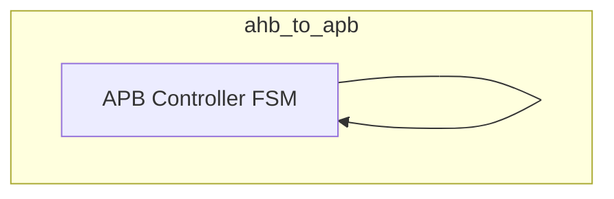
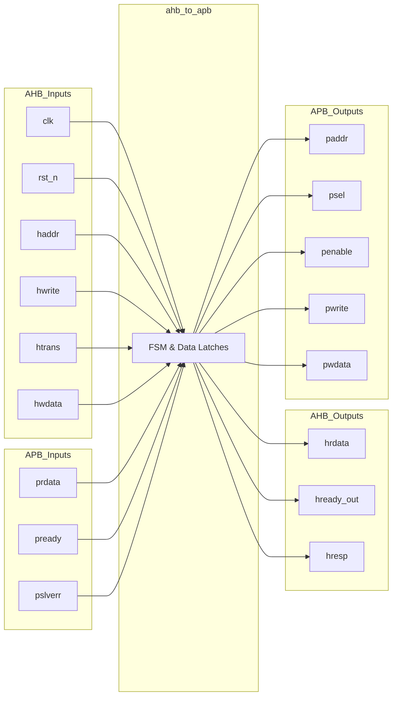
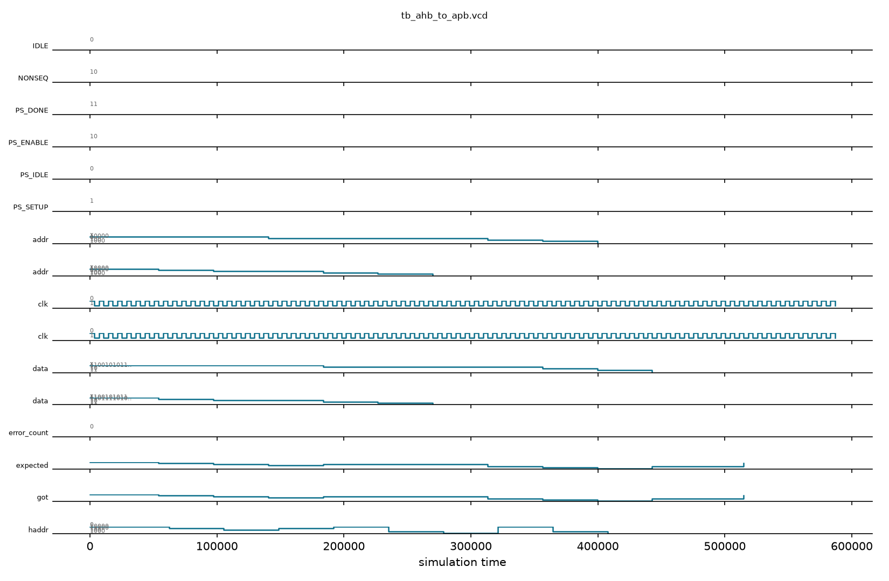

# ahb_to_apb

## Description

The AHB3 to APB4 Bridge serves as the secondary interface in the SMVDU-TITAN-X SoC for communicating with low-bandwidth, memory-mapped peripherals. It bridges 32-bit AHB3-Lite transactions to the simpler 32-bit APB4 protocol. By interpreting the AHB address and control phase (specifically looking for `NONSEQ` or `SEQ` transfers via `htrans[1]`), it drives an APB SETUP phase followed by an ENABLE phase, stalling the AHB bus (`hready_out` = 0) until the APB peripheral completes the transfer (`pready` = 1). This ensures precise translation without losing transfers, simplifying integration for typical register-based IP blocks.

## Interface

### Inputs

| Signal | Width | Description |
|--------|-------|-------------|
| clk | 1 | System clock |
| rst_n | 1 | Active-low asynchronous reset |
| haddr | 32 | AHB transaction address |
| hwrite | 1 | AHB write transfer flag |
| htrans | 2 | AHB transfer type (IDLE, BUSY, NONSEQ, SEQ) |
| hwdata | 32 | AHB write data |
| prdata | 32 | APB read data |
| pready | 1 | APB ready signal from the peripheral |
| pslverr | 1 | APB slave error signal |

### Outputs

| Signal | Width | Description |
|--------|-------|-------------|
| hrdata | 32 | AHB read data (captured from APB read data) |
| hready_out | 1 | AHB ready output (stalls AHB bus during APB access) |
| hresp | 1 | AHB response signal (tied to OKAY / 0) |
| paddr | 32 | APB address |
| psel | 1 | APB select signal (setup phase) |
| penable | 1 | APB enable signal (access phase) |
| pwrite | 1 | APB write flag |
| pwdata | 32 | APB write data |

## Functionality

The bridge implements a simple finite state machine to span the AHB and APB timing requirements. In `PS_IDLE`, it monitors `htrans` to detect active transfers (`htrans[1]`). When a transfer is detected, it immediately latches the address, write flag, and write data into the APB interface, asserts `psel`, and pulls `hready_out` low to stall the AHB master. In the next cycle (`PS_ENABLE`), it asserts `penable` to begin the APB access phase. It waits in this state until the APB slave asserts `pready`. Upon completion, it captures the read data into `hrdata`, clears the APB control signals, asserts `hready_out`, and returns to `PS_IDLE` for the next transaction.

## Hierarchical Block Diagram



## Signal-Level Diagram



## Verification & Test Results

### Test Strategy
The testbench (`tb_ahb_to_apb.v`) verifies AHB3-Lite to APB4 protocol conversion against a responsive APB slave register model:
1. **TEST 1: AHB Response Status**: Verify `hresp` is continuously tied to 0 (OKAY).
2. **TEST 2: AHB Single Write**: Drive AHB non-sequential write to address `0x10` with data `0xCAFEBABE`; check APB setup and access phase, verifying register write.
3. **TEST 3: Distinct Address Write**: Drive AHB write to `0x1C` with data `0xDEADBEEF`; verify APB memory bank update.
4. **TEST 4: AHB Single Read**: Read address `0x10` via AHB; verify read data `0xCAFEBABE` matches APB register contents.
5. **TEST 5: Back-to-Back Sequential Writes**: Execute back-to-back writes to `0x00`, `0x04`, `0x08` and verify all registers update without loss or stall deadlock.
6. **TEST 6: Sequential Reads**: Read back addresses `0x00`, `0x04`, `0x08` in sequence; ensure `hrdata` accurately captures peripheral read words.
7. **TEST 7: AHB IDLE Transfers**: Verify that `htrans == IDLE` does not assert `psel` or cause spurious APB transactions.

### Simulation Transcript
```text
VCD info: dumpfile tb_ahb_to_apb.vcd opened for output.

--- TEST 1: hresp = OKAY ---
PASS [54000]                     hresp = OKAY

--- TEST 2: AHB write → APB forwarding ---
PASS [97000] 4] = 0xCAFE_BABE after AHB write

--- TEST 3: AHB write addr 0x1C ---
PASS [140000] 7] = 0xDEAD_BEEF after AHB write

--- TEST 4: AHB read ← APB ---
PASS [184000]  hrdata = 0xCAFE_BABE (AHB read)

--- TEST 5: Back-to-back writes ---
PASS [313000]                     apb_mem[0]=1
PASS [313000]                     apb_mem[1]=2
PASS [313000]                     apb_mem[2]=3

--- TEST 6: Sequential reads ---
PASS [356000]                    ahb_read[0]=1
PASS [400000]                    ahb_read[1]=2
PASS [443000]                    ahb_read[2]=3

--- TEST 7: IDLE → no APB activity ---
PASS [515000]           psel=0 during AHB IDLE

==============================
AHB-to-APB VERDICT: ✅ PASS — All tests passed
==============================
```

### Digital Waveform


