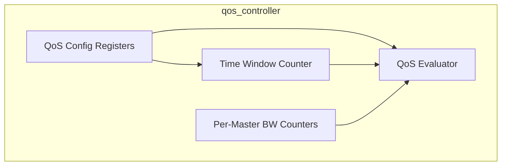
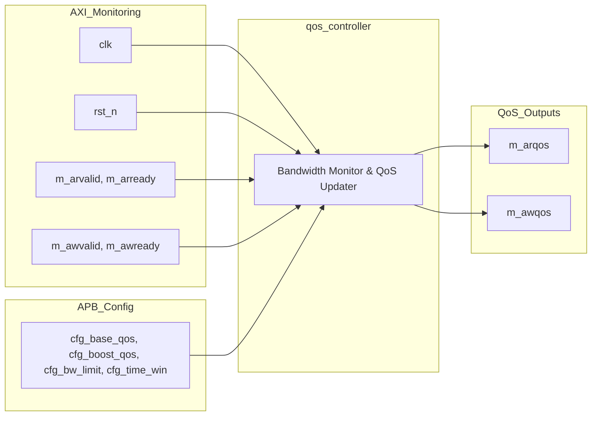
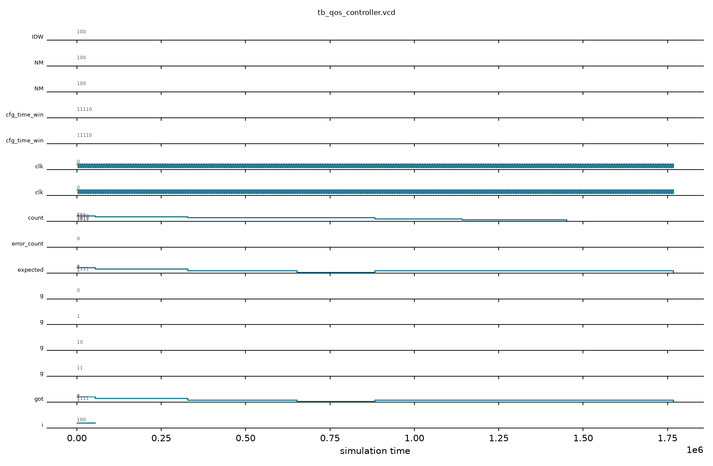

# qos_controller

## Description

The QoS Controller dynamically manages the AXI Quality of Service (QoS) signaling for all 15 master ports in the SMVDU-TITAN-X SoC. Its goal is to prevent high-bandwidth peripherals, such as Video DMAs and PCIe controllers, from starving critical real-time components. The controller is programmed via an APB interface with a global time window and per-master bandwidth thresholds. It continuously monitors accepted AXI address handshakes (`AR` and `AW`) within the programmed time window. At the end of each window, masters that exceeded their transaction limit are throttled to a lower base QoS level, while masters within their limit receive a boosted QoS level for the next window.

## Interface

### Inputs

| Signal | Width | Description |
|--------|-------|-------------|
| clk | 1 | System clock |
| rst_n | 1 | Active-low asynchronous reset |
| cfg_base_qos | 4 × 15 | Base QoS value per master (when throttled) |
| cfg_boost_qos | 4 × 15 | Boost QoS value per master (when within limits) |
| cfg_bw_limit | 16 × 15 | Bandwidth threshold in transactions per window per master |
| cfg_time_win | 16 | Global time window for bandwidth measurement (clock cycles) |
| m_arvalid | NM (15) | Read address valid flags monitored across all masters |
| m_arready | NM (15) | Read address ready flags monitored across all masters |
| m_awvalid | NM (15) | Write address valid flags monitored across all masters |
| m_awready | NM (15) | Write address ready flags monitored across all masters |

### Outputs

| Signal | Width | Description |
|--------|-------|-------------|
| m_arqos | 4 × 15 | Dynamically computed read QoS signals for all masters |
| m_awqos | 4 × 15 | Dynamically computed write QoS signals for all masters |

## Functionality

The controller uses a global 16-bit counter (`time_cnt`) to track the measurement window defined by `cfg_time_win`. Concurrently, 15 individual counters (`bw_cnt`) tally the total number of accepted read and write address handshakes for each master. When the time window expires, the controller evaluates each master's bandwidth usage against its `cfg_bw_limit`. If a master has exceeded its limit, its `cur_arqos` and `cur_awqos` registers are assigned the `cfg_base_qos` value (throttling its priority in the interconnect). If the master is within its limit, it is assigned the `cfg_boost_qos` value. All bandwidth counters and the time window counter are then reset for the next measurement interval. The computed QoS values are continuously driven out to replace the default AXI QoS signals on the interconnect.

## Hierarchical Block Diagram



## Signal-Level Diagram



## Verification & Test Results

### Test Strategy
The testbench (`tb_qos_controller.v`) verifies the dynamic QoS allocation, bandwidth monitoring, window expiration, and throttling recovery across the following tests:
1. **TEST 1: Reset Behavior**: Verify `m_arqos` and `m_awqos` default to 0 during reset.
2. **TEST 2: Normal Under-Limit Transactions**: Confirm master 0 receives boost QoS (`0xF`) when bandwidth count (5) is under limit (10).
3. **TEST 3: Over-Limit Throttling**: Confirm master 1 is throttled to base QoS (`0x1`) when bandwidth count (12) exceeds limit (10).
4. **TEST 4: Idle Master Behavior**: Confirm idle master 2 receives boost QoS.
5. **TEST 5: QoS Recovery**: Confirm master 1 recovers to boost QoS in the next window after traffic ceases.
6. **TEST 6: Boundary Condition**: Verify 10 transactions (exactly at limit) maintains boost QoS.
7. **TEST 7: Boundary Violation**: Verify 11 transactions (1 above limit) immediately triggers throttling.

### Simulation Transcript
```text
VCD info: dumpfile tb_qos_controller.vcd opened for output.

--- TEST 1: QoS outputs = 0 after reset ---
PASS [54000]            m_arqos=0 after reset = 0
PASS [54000]            m_awqos=0 after reset = 0
PASS [54000]            m_arqos=0 after reset = 0
PASS [54000]            m_awqos=0 after reset = 0
PASS [54000]            m_arqos=0 after reset = 0
PASS [54000]            m_awqos=0 after reset = 0
PASS [54000]            m_arqos=0 after reset = 0
PASS [54000]            m_awqos=0 after reset = 0

--- TEST 2: Under limit → boost QoS ---
PASS [328000] boost_qos=F (5 trans < limit 10) = 15
PASS [328000]         Master 0 awqos=F (boost) = 15

--- TEST 3: Over limit → base QoS ---
PASS [652000] 1 throttled base_qos=1 (12 > 10) = 1

--- TEST 4: Idle master → boost QoS ---
PASS [882000]  2 idle → boost_qos=F (0 < 10) = 15

--- TEST 5: QoS recovers (3 trans in window after throttle) ---
PASS [1141000] aster 1 recovered to boost_qos=F = 15

--- TEST 6: Exactly at limit (10) → boost (not > 10) ---
PASS [1451000] trans → still boost (10 !> 10) = 15

--- TEST 7: One over limit (11) → throttle ---
PASS [1768000] 11 trans → throttled (11 > 10) = 1

==============================
QoS VERDICT: ✅ PASS — All tests passed
==============================
```

### Digital Waveform


