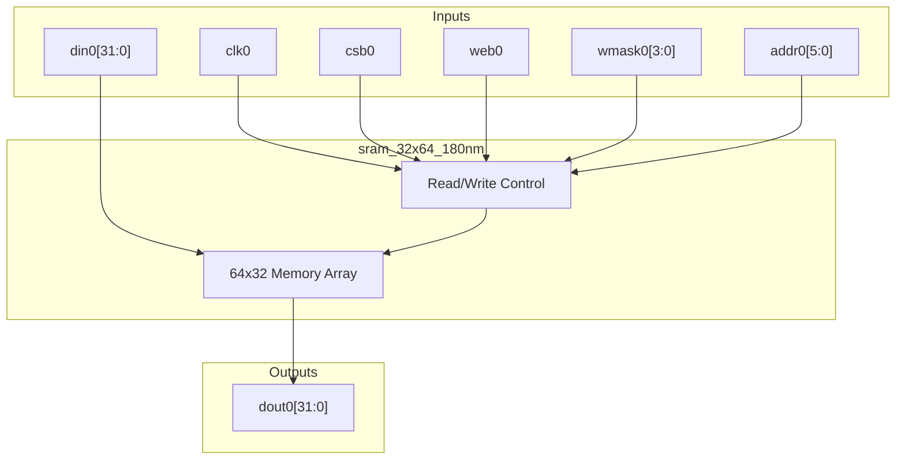
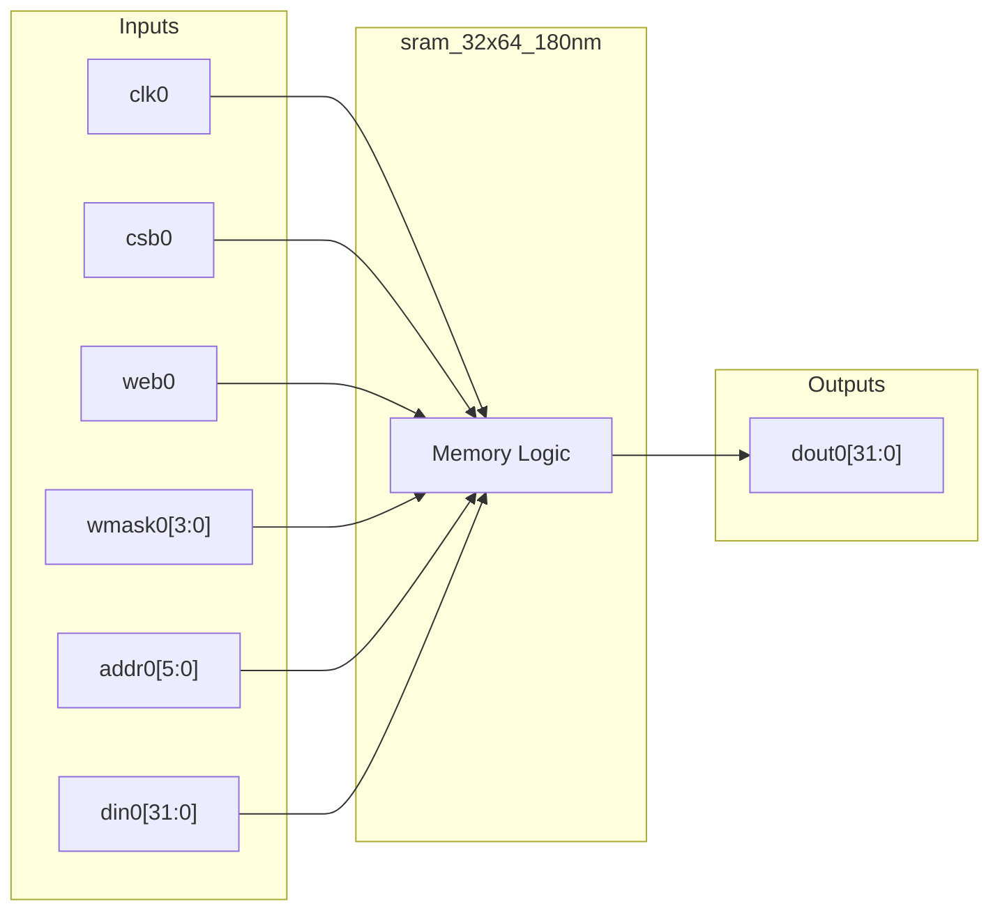
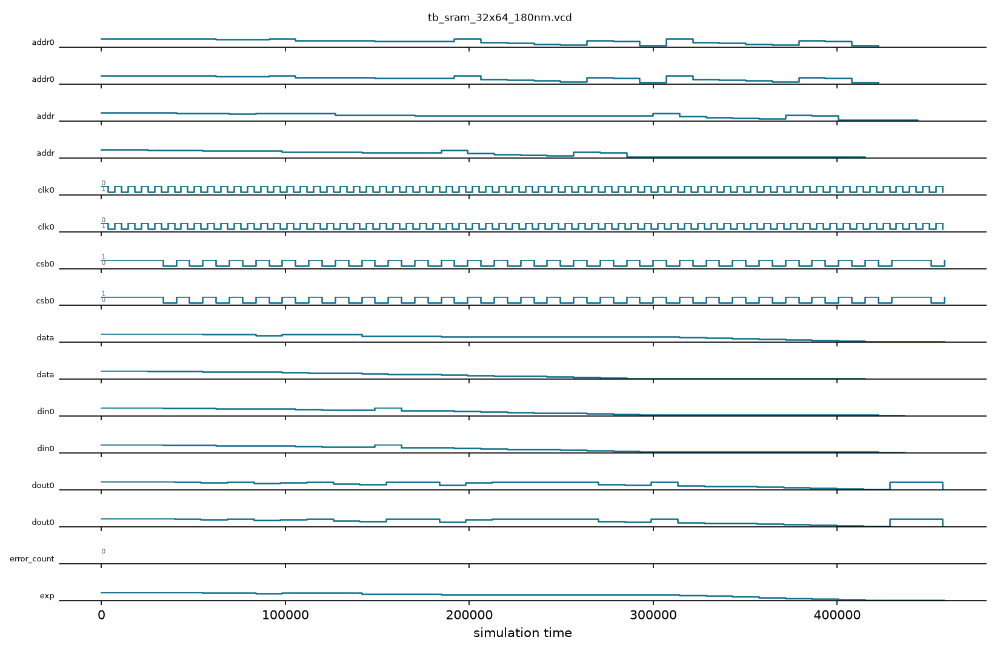

# sram_32x64_180nm

## Description

This module provides a behavioral simulation model for an SCL 180nm SRAM hard macro, featuring a 64-word by 32-bit storage array. It implements a synchronous read/write interface with active-low chip select and write enable signals. The memory supports byte-level write masking, allowing individual bytes within a 32-bit word to be updated independently. It features write-first behavior, meaning read operations during a write cycle will return the newly written data.

## Interface

### Inputs

| Signal | Width | Description |
|--------|-------|-------------|
| clk0   | 1     | System clock |
| csb0   | 1     | Active-low chip select |
| web0   | 1     | Active-low write enable |
| wmask0 | 4     | Active-high byte write mask (1=write byte) |
| addr0  | 6     | 6-bit address selecting one of 64 words |
| din0   | 32    | 32-bit data input for writes |

### Outputs

| Signal | Width | Description |
|--------|-------|-------------|
| dout0  | 32    | 32-bit data output for reads |

## Functionality

The module maintains an internal 64-entry by 32-bit array, initially cleared to zero for simulation purposes. On the rising edge of `clk0`, the memory evaluates the `csb0` chip select. If selected, a write occurs if `web0` is low, conditionally updating up to 4 bytes at `addr0` depending on the `wmask0` bits. Regardless of whether a write occurs, the data at `addr0` is registered into `dout0`. If the module is not selected, `dout0` holds its previous value to prevent floating outputs, mimicking typical SRAM macro retention.

## Hierarchical Block Diagram



## Signal-Level Diagram



## Verification & Testbench Details

### Verification Strategy
The `sram_32x64_180nm` memory macro simulation model is verified via directed functional operations in `tb_sram_32x64_180nm.v`:
1. **Full-Word Read/Write**: Verifies writing and reading 32-bit test vectors (`0xDEADBEEF`, `0xCAFEBABE`) at boundary addresses (`addr=0` and `addr=63`).
2. **Address Independence**: Confirms that writing to the highest address does not corrupt lower address contents.
3. **Byte-Level Write Masking**: Exercises active-high byte masks (`wmask=4'b0011` and `wmask=4'b1100`), verifying that masked bytes remain uncorrupted while target bytes are written accurately.
4. **Sequential Address Sweep**: Iteratively writes and reads distinct pattern data across addresses `0` to `7`.
5. **Chip Select Inhibit**: Asserts `csb0=1` (chip unselected) during active write attempts, confirming memory retention without corruption.

### Simulation Transcript
```text
VCD info: dumpfile tb_sram_32x64_180nm.vcd opened for output.

--- TEST 1: Write/read word ---
PASS [55000]             addr[0] = 0xDEADBEEF

--- TEST 2: Last address ---
PASS [84000]            addr[63] = 0xCAFEBABE

--- TEST 3: Address independence ---
PASS [98000] [0] unaffected by addr[63] write

--- TEST 4: Byte mask write ---
PASS [141000]          byte mask [1:0] written
PASS [141000]        byte mask [3:2] unchanged

--- TEST 5: Upper byte mask ---
PASS [185000] yte mask [3:2] written to addr 6
PASS [185000] e mask [1:0] unchanged at addr 6

--- TEST 6: Sequential address sweep (addr 0-7) ---
PASS [314000]         sequential address sweep
PASS [329000]         sequential address sweep
PASS [343000]         sequential address sweep
PASS [357000]         sequential address sweep
PASS [372000]         sequential address sweep
PASS [386000]         sequential address sweep
PASS [401000]         sequential address sweep
PASS [415000]         sequential address sweep

--- TEST 7: CSB=1 no write ---
PASS [458000]           CSB=1: no write occurs

==============================
SRAM_32x64 VERDICT: ✅ PASS — All tests passed
==============================
```

### Digital Waveform

