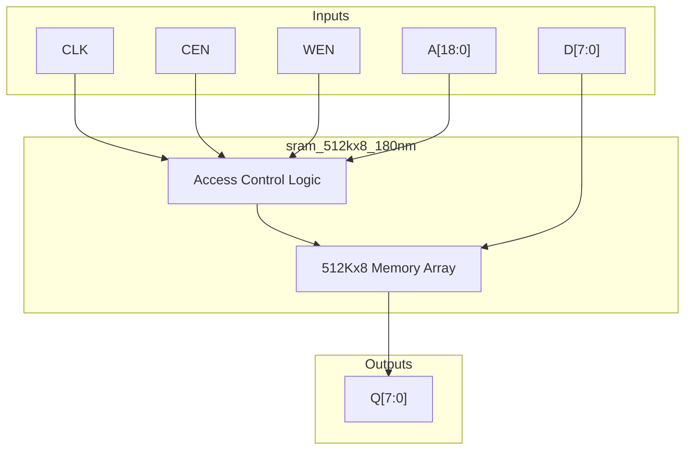
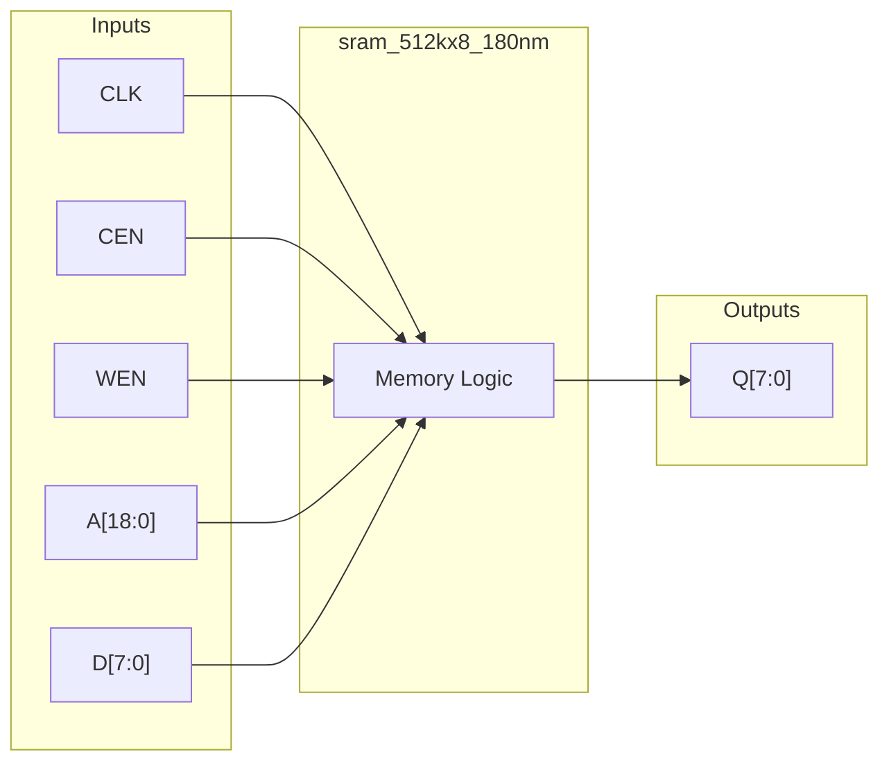
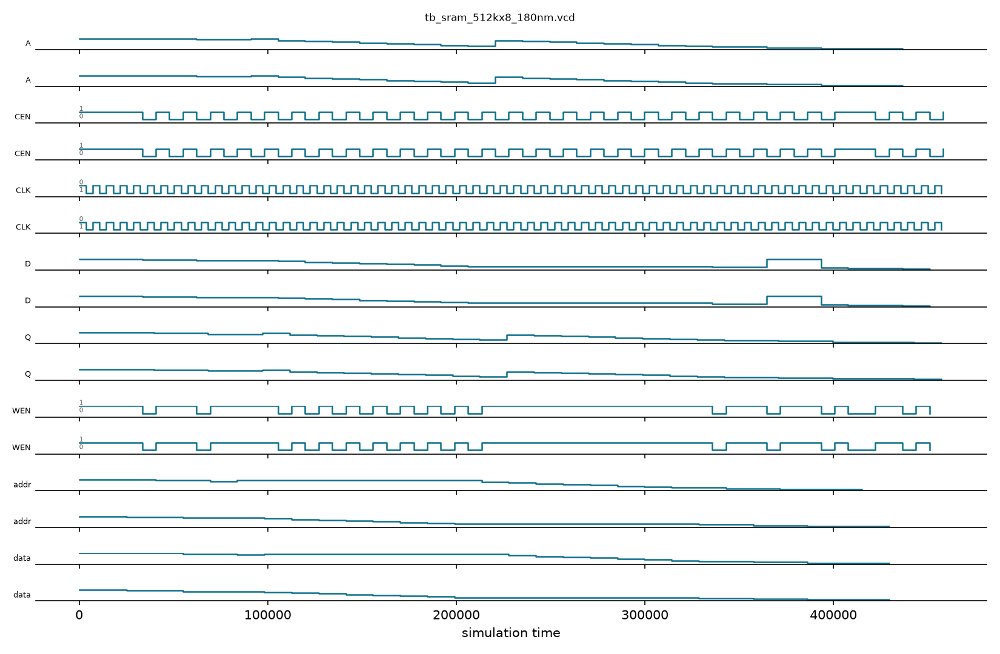

# sram_512kx8_180nm

## Description

This module is a behavioral simulation model for a 512KB SRAM macro targeted for the SCL 180nm CMOS process. It represents a large memory block configured as 524,288 words by 8 bits (4Mb total). The module uses a standard synchronous interface with active-low chip enable and write enable signals. During physical synthesis, this behavioral model is intended to be replaced by a compiled hard macro generated from a foundry memory compiler.

## Interface

### Inputs

| Signal | Width | Description |
|--------|-------|-------------|
| CLK    | 1     | System clock |
| CEN    | 1     | Active-low chip enable |
| WEN    | 1     | Active-low write enable |
| A      | 19    | 19-bit address bus for accessing 512K locations |
| D      | 8     | 8-bit data input for write operations |

### Outputs

| Signal | Width | Description |
|--------|-------|-------------|
| Q      | 8     | 8-bit data output from read operations |

## Functionality

The core of the module is a 512K by 8-bit register array (`mem`). On the rising edge of `CLK`, the memory examines the `CEN` signal. If `CEN` is low, the module becomes active. If `WEN` is also low, a write operation occurs, storing the 8-bit data `D` into the location specified by address `A`; it concurrently assigns `D` to output `Q`, demonstrating write-first (transparent) behavior. If `WEN` is high, a read operation occurs, and the data at address `A` is passed to the output register `Q`.

## Hierarchical Block Diagram



## Signal-Level Diagram



## Verification & Testbench Details

### Verification Strategy
The `sram_512kx8_180nm` memory macro simulation model is verified via directed tests across its full 19-bit (512K location) address space in `tb_sram_512kx8_180nm.v`:
1. **Boundary Access Verification**: Tests single-byte write and read transactions at base address `19'h00000` (`0xAB`) and top address `19'h7FFFF` (`0xCD`).
2. **Address Independence**: Verifies that writing to the maximum memory boundary does not mutate base address contents.
3. **Sequential Byte Sweeps**: Writes incremental data across address offset ranges (`addr=100..107`) to test sequential access stability.
4. **Data Bit Patterns**: Validates all-ones (`0xFF`) and all-zeros (`0x00`) data storage fidelity.
5. **Chip Enable Gating**: Sets `CEN=1` during active write assertions to prove complete write gating.
6. **Write-First Transparency**: Confirms that data output `Q` immediately reflects the write input `D` on cycles where `CEN=0` and `WEN=0`.

### Simulation Transcript
```text
VCD info: dumpfile tb_sram_512kx8_180nm.vcd opened for output.

--- TEST 1: Basic write/read ---
PASS [55000]                   addr[0] = 0xAB

--- TEST 2: Last address (0x7FFFF) ---
PASS [84000]               addr[7FFFF] = 0xCD

--- TEST 3: Address independence ---
PASS [98000]  unchanged after last addr write

--- TEST 4: Sequential byte sweep ---
PASS [228000]            sequential byte sweep
PASS [242000]            sequential byte sweep
PASS [257000]            sequential byte sweep
PASS [271000]            sequential byte sweep
PASS [285000]            sequential byte sweep
PASS [300000]            sequential byte sweep
PASS [314000]            sequential byte sweep
PASS [329000]            sequential byte sweep

--- TEST 5: All-ones (0xFF) ---
PASS [357000]                 addr[200] = 0xFF

--- TEST 6: All-zeros (0x00) ---
PASS [386000]                 addr[201] = 0x00

--- TEST 7: CEN=1 no write ---
PASS [429000]           CEN=1: no write occurs

--- TEST 8: Write-first transparency ---
PASS [458000]  Q shows new data on write cycle

==============================
SRAM_512Kx8 VERDICT: ✅ PASS — All tests passed
==============================
```

### Digital Waveform

