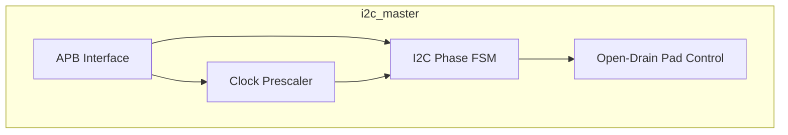
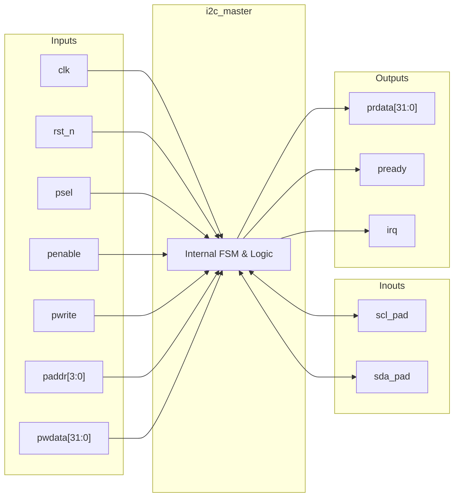
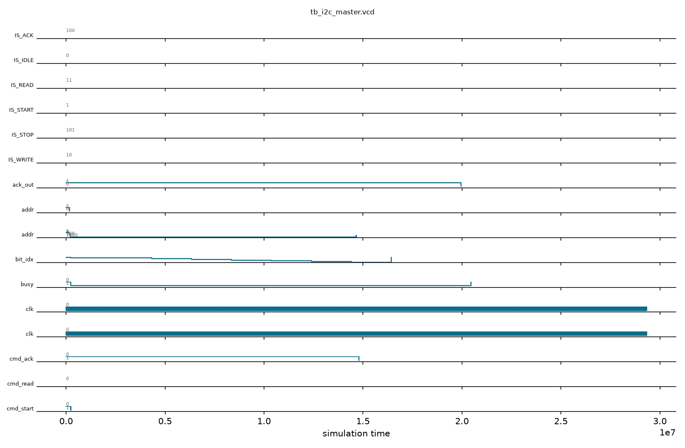

# i2c_master

## Description

The `i2c_master` module is an APB-slave peripheral designed for the SMVDU-TITAN-X SoC, functioning as a byte-level I2C master controller. It abstracts I2C bus transactions into register commands, allowing the host to trigger START, STOP, READ, and WRITE operations. Key architectural features include a configurable prescaler to set the I2C clock frequency (SCL) and a dedicated byte-oriented finite state machine (FSM). The module manages the complex timing and phase shifting required by the I2C protocol, handles open-drain output control for SCL and SDA internally, and flags an interrupt upon completion of ongoing operations.

## Interface

### Inputs

| Signal | Width | Description |
|--------|-------|-------------|
| clk    | 1     | System clock |
| rst_n  | 1     | Active-low asynchronous reset |
| psel   | 1     | APB select signal, indicates the slave is selected |
| penable| 1     | APB enable signal, indicates the second cycle of an APB transfer |
| pwrite | 1     | APB write enable signal |
| paddr  | 4     | APB address bus for register selection |
| pwdata | 32    | APB write data bus |

### Inouts

| Signal | Width | Description |
|--------|-------|-------------|
| scl_pad| 1     | I2C serial clock line (open-drain, externally pulled up) |
| sda_pad| 1     | I2C serial data line (open-drain, externally pulled up) |

### Outputs

| Signal | Width | Description |
|--------|-------|-------------|
| prdata | 32    | APB read data bus |
| pready | 1     | APB ready signal, hardwired to 1 (zero wait states) |
| irq    | 1     | Interrupt request signal, asserted when the controller is not busy |

## Functionality

The controller interfaces with the system CPU via the APB bus. Through memory-mapped registers, the host writes data, sets the clock prescaler, and issues specific I2C commands (e.g., START, STOP, WRITE). When an action is initiated, a phase-driven FSM steps through the I2C protocol. A prescaler divides the system clock into four discrete phase ticks per I2C clock cycle. The FSM uses these phases to precisely control the timing of SDA and SCL transitions to generate valid START and STOP conditions, shift out byte data bit-by-bit (MSB first), and sample acknowledgment bits (ACK) from the slave. The `scl_pad` and `sda_pad` lines are treated as open-drain signals by driving them low when active or setting them to high-impedance (`1'bz`) to let an external pull-up resistor pull the line high.

## Hierarchical Block Diagram



## Signal-Level Diagram



## Verification & Test Results

### Test Strategy
The testbench (`tb_i2c_master.v`) verifies the APB slave registers, programmable prescaler, open-drain pad pull-ups, and 4-phase protocol FSM for START, WRITE, and STOP transactions:
1. **TEST 1: APB Handshake**: Verifies `pready=1` following reset release.
2. **TEST 2: Open-Drain Line Idle States**: Confirms both `scl_pad` and `sda_pad` idle at logic high (`1`) via open-drain pullups.
3. **TEST 3: Prescaler Programming**: Programs `prescale=69` (for 400 kHz Fast-Mode at 138.8 MHz) and verifies readback.
4. **TEST 4: START + Address Write**: Transmits address byte `0xA0` (slave `0x50` write) with `cmd_start=1` and `cmd_write=1`; verifies SCL toggling (13 clock edges observed) and SDA transitions.
5. **TEST 5: Busy Status Flag**: Confirms `busy` bit (bit 31) asserts in status register during byte transmission.
6. **TEST 6: STOP Condition**: Issues `cmd_stop=1` command; validates SDA rising while SCL is high, cleanly releasing the bus.

### Simulation Transcript
```text
VCD info: dumpfile tb_i2c_master.vcd opened for output.

--- TEST 1: pready ---
PASS [104000]             pready=1 after reset

--- TEST 2: SCL/SDA idle high ---
PASS [140000]           SCL idle=1 (pulled up)
PASS [140000]           SDA idle=1 (pulled up)

--- TEST 3: Prescaler programming ---
PASS [186000]          Prescaler readback = 69

--- TEST 4: START + WRITE slave addr 0x50 ---
PASS [14627000] SCL toggled: 13 edges observed

--- TEST 5: Busy bit check ---
  Status reg: busy=1, prescale=0x0045

--- TEST 6: STOP command ---
PASS [29185000]                 SCL=1 after STOP
PASS [29185000]      SDA=1 after STOP (released)

==============================
I2C VERDICT: ✅ PASS — All tests passed
==============================
```

### Digital Waveform


