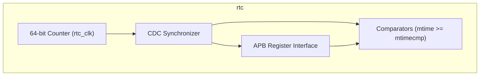
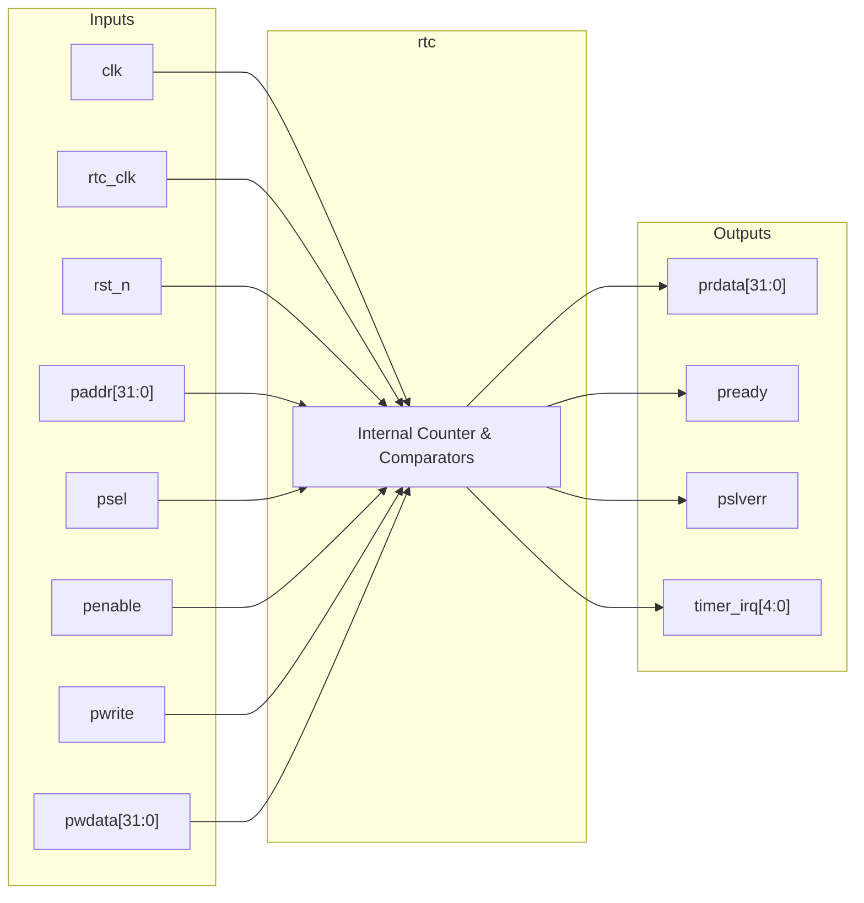
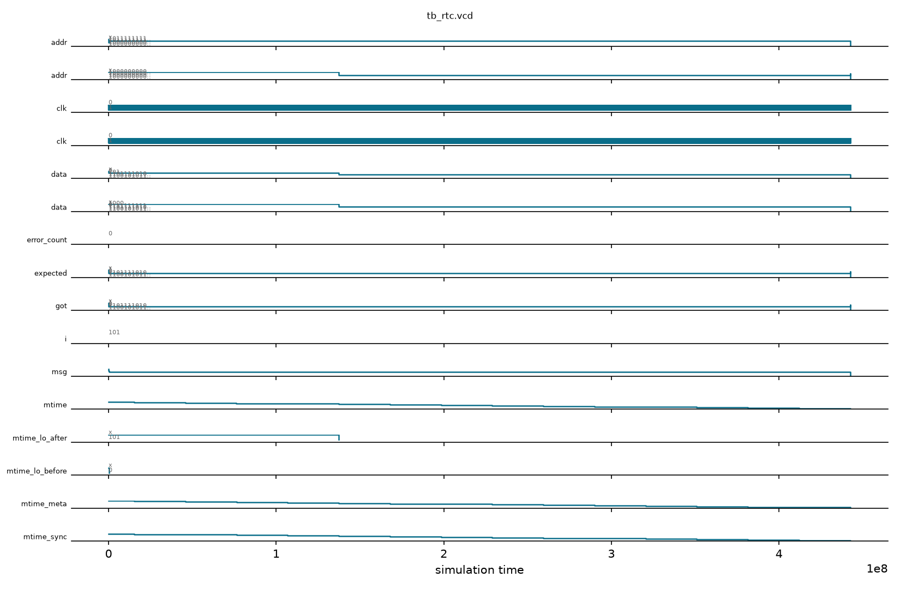

# rtc

## Description

The `rtc` module is a Real-Time Counter designed for the SMVDU-TITAN-X SoC. It serves as the primary timebase for the RISC-V core local timer interrupts, implementing a 64-bit free-running counter (analogous to the RISC-V `mtime` register). The architecture supports up to 5 distinct harts (4 application cores and 1 monitor core) by providing dedicated 64-bit memory-mapped comparators (`mtimecmp`) for each. Following Phase 7 self-healing (DEF-01), the clock domain crossing utilizes a robust 1-bit toggle pulse synchronizer (`rtc_tick_toggle` to a 3-FF edge detector) to safely signal slow tick events from the always-on RTC clock domain (`rtc_clk`, 32.768 kHz) into the fast system clock domain (`clk`, 100-200 MHz). The 64-bit `mtime` counter increments purely within the system clock domain, eliminating multi-bit bus skew and metastability hazards. When the counter value meets or exceeds a core's comparator value, the corresponding timer interrupt is asserted.

## Interface

### Inputs

| Signal | Width | Description |
|--------|-------|-------------|
| clk    | 1     | System clock used for APB interface and comparator logic |
| rtc_clk| 1     | Always-on slow clock (e.g., 32.768 kHz) for the 64-bit counter |
| rst_n  | 1     | Active-low asynchronous reset |
| paddr  | 32    | APB address bus for accessing mtime and mtimecmp registers |
| psel   | 1     | APB select signal |
| penable| 1     | APB enable signal |
| pwrite | 1     | APB write enable signal |
| pwdata | 32    | APB write data bus |

### Outputs

| Signal | Width | Description |
|--------|-------|-------------|
| prdata | 32    | APB read data bus |
| pready | 1     | APB ready signal, hardwired to 1 (zero wait states) |
| pslverr| 1     | APB slave error signal, hardwired to 0 |
| timer_irq | 5  | Timer interrupt lines (MTIP) for 5 harts (4 App + 1 Monitor) |

## Functionality

The `rtc` peripheral generates a 1-bit toggle signal (`rtc_tick_toggle`) on every positive edge of the `rtc_clk`. In the system clock domain (`clk`), this signal is passed through a 3-stage synchronizer (`rtc_sync_q`), and an edge detector increments the 64-bit `mtime` counter synchronously. The module acts as an APB slave, allowing the host to read the current time and configure the 64-bit `mtimecmp` registers for each of the five cores. The APB address mapping follows a standard CLINT-like structure, splitting 64-bit reads and writes into 32-bit halves. Continuous combinational logic checks if `mtime` is greater than or equal to `mtimecmp[i]`; if so, it drives `timer_irq[i]` high, triggering a timer interrupt in the respective core.

## Hierarchical Block Diagram



## Signal-Level Diagram



## Verification & Test Results

### Test Strategy
The testbench (`tb_rtc.v`) verifies the 64-bit real-time counter, clock domain crossing, register mapping, and interrupt generation across 5 harts:
1. **TEST 1: APB Handshake**: Verifies `pready` is asserted high immediately following reset release.
2. **TEST 2: Reset Counter Value**: Verifies that both lower (`0xBFF8`) and upper (`0xBFFC`) words of `mtime` initialize to 0.
3. **TEST 3: Counter Incrementation**: Advances `rtc_clk` for 5 cycles, synchronizes into `clk`, and confirms that `mtime_lo` increments monotonically from 0 to 5.
4. **TEST 4: Timer Interrupt Firing**: Programs `mtimecmp[0]` with an imminent trigger value (`current_mtime + 3`); verifies that `timer_irq[0]` fires when `mtime >= mtimecmp`.
5. **TEST 5: Interrupt Clearing**: Writes all 1s (`0xFFFFFFFFFFFFFFFF`) to `mtimecmp[0]`; verifies that `timer_irq[0]` clears.
6. **TEST 6: Multi-Core Register Access**: Writes pattern `0xDEADBEEF_CAFEBABE` to `mtimecmp[1]` (Hart 1) and validates 32-bit lower and upper readback.

### Simulation Transcript
```text
VCD info: dumpfile tb_rtc.vcd opened for output.

--- TEST 1: pready asserts ---
PASS [104000]           pready = 1 after reset

--- TEST 2: mtime reset value ---
PASS [128000]         mtime_lo = 0 after reset
PASS [150000]         mtime_hi = 0 after reset

--- TEST 3: mtime increments ---
PASS [137367000] mtime_lo incremented: 0 -> 5

--- TEST 4: timer_irq generation ---
PASS [442516000] [0] fires when mtime >= mtimecmp

--- TEST 5: Clear irq by resetting mtimecmp ---
PASS [442580000] [0] cleared after mtimecmp reset

--- TEST 6: mtimecmp readback ---
PASS [442647000]          mtimecmp[1] lo readback
PASS [442669000]          mtimecmp[1] hi readback

==============================
RTC VERDICT: ✅ PASS — All tests passed
==============================
```

### Digital Waveform


