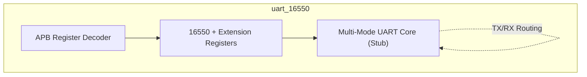
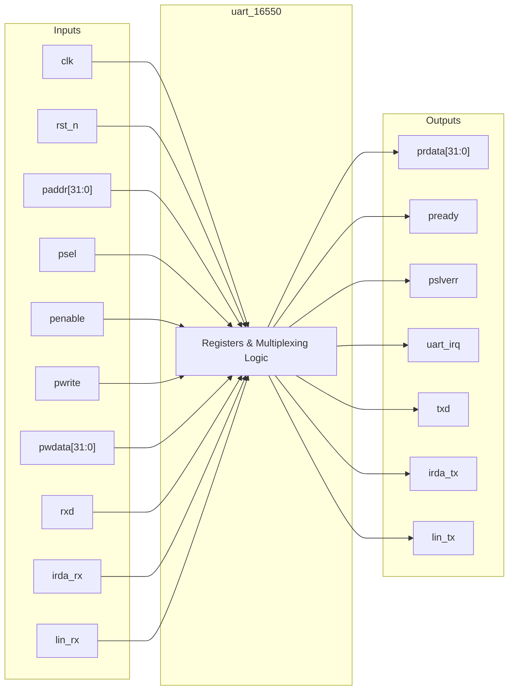
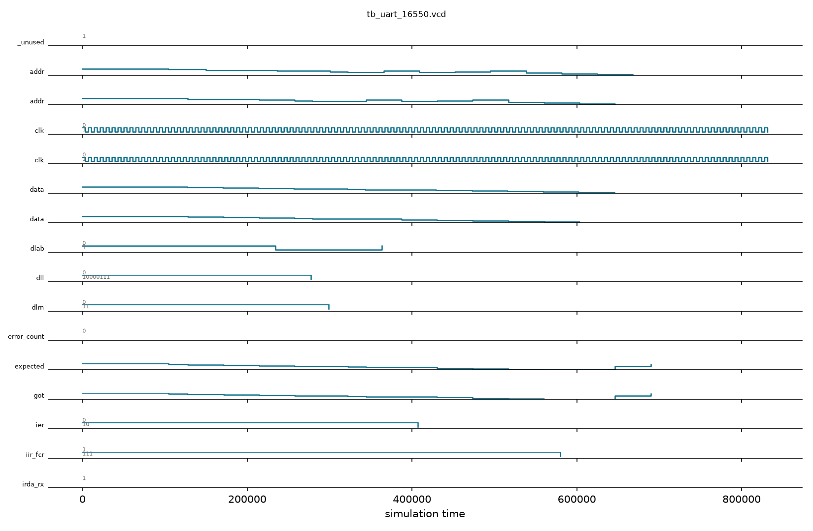

# uart_16550

## Description

The `uart_16550` module is a Multi-Mode UART designed for the SMVDU-TITAN-X SoC, building upon the industry-standard 16550 architecture. In addition to conventional asynchronous serial communication, this iteration introduces support for advanced protocols including IrDA (Infrared Data Association), LIN (Local Interconnect Network) bus, and 9-bit data frames. The core provides a standard APB slave interface that implements traditional 16550 memory-mapped registers alongside custom extension registers (`mode_cr`, `nbit_cr`) for configuring the advanced modes. While the complex physical layer processing logic is currently stubbed, the module establishes the structural and memory framework necessary for multiplexing standard TX/RX paths to specialized protocol endpoints.

## Interface

### Inputs

| Signal | Width | Description |
|--------|-------|-------------|
| clk    | 1     | System clock |
| rst_n  | 1     | Active-low asynchronous reset |
| paddr  | 32    | APB address bus |
| psel   | 1     | APB select signal |
| penable| 1     | APB enable signal |
| pwrite | 1     | APB write enable signal |
| pwdata | 32    | APB write data bus |
| rxd    | 1     | Standard UART receive line |
| irda_rx| 1     | IrDA receive line |
| lin_rx | 1     | LIN bus receive line |

### Outputs

| Signal | Width | Description |
|--------|-------|-------------|
| prdata | 32    | APB read data bus |
| pready | 1     | APB ready signal, hardwired to 1 |
| pslverr| 1     | APB slave error signal, hardwired to 0 |
| uart_irq | 1   | UART interrupt request line |
| txd    | 1     | Standard UART transmit line |
| irda_tx| 1     | IrDA transmit line |
| lin_tx | 1     | LIN bus transmit line |

## Functionality

The `uart_16550` core functions as an APB-slave device, decoding register accesses based on the APB address bus. The module implements the conventional 16550 register map, utilizing the Divisor Latch Access Bit (`dlab` from the LCR) to multiplex accesses to the transmit/receive buffers and the baud rate divisor latches (`dll`, `dlm`). It expands upon the standard by introducing `mode_cr` to switch between UART, IrDA, and LIN modes, and `nbit_cr` to toggle 9-bit operation. The actual physical data transmission and reception (baud generation, framing, and serialization) are placeholders in this version, represented by static idle assignments (e.g., driving `txd` high and `irda_tx` low). Software drivers interact with this module identically to a legacy 16550 UART, with the addition of the extended protocol toggles.

## Hierarchical Block Diagram



## Signal-Level Diagram



## Verification & Test Results

### Test Strategy
The testbench (`tb_uart_16550.v`) verifies the 16550-compatible register file, Divisor Latch Access Bit (DLAB) paging, extension registers, and serial line idle defaults:
1. **TEST 1: APB Handshake**: Verifies `pready=1` and `pslverr=0` combinatorially following reset.
2. **TEST 2: LSR Reset Defaults**: Verifies Line Status Register (`0x14`) resets to `0x60` (Transmitter Holding Register Empty and Transmitter Empty flags asserted).
3. **TEST 3: Scratch Register R/W**: Writes alternating bit patterns (`0xA5`, `0x5A`) to the Scratch Register (`0x1C`) and validates readback.
4. **TEST 4: DLAB Paged Access (DLL / DLM)**: Sets `DLAB=1` via LCR (`0x0C`), writes baud divisor bytes `DLL=0x87` and `DLM=0x03` (equivalent to 9600 baud at 138.8 MHz), and validates readback.
5. **TEST 5: Normal Mode Paging (THR / IER)**: Clears `DLAB=0`, writes and verifies Interrupt Enable Register (`IER=0x02`), and validates that offsets `0x00`/`0x04` access standard buffers rather than divisor latches.
6. **TEST 6: Line Control Register (LCR)**: Tests programming word length, stop bits, and parity configurations (`0x1F`).
7. **TEST 7: Modem Control Register (MCR)**: Configures loopback mode (`0x10`) and verifies readback.
8. **TEST 8: FIFO Control Register (FCR)**: Tests write access to FCR (`0x08`).
9. **TEST 9: Mode Extensions**: Validates IrDA/LIN mode control register (`mode_cr=0x01`) and 9-bit framing register (`nbit_cr=0x01`).
10. **TEST 10: Serial Line Idle States**: Verifies UART `txd=1` (idle mark), `lin_tx=1` (idle high), and `irda_tx=0` (idle space).

### Simulation Transcript
```text
VCD info: dumpfile tb_uart_16550.vcd opened for output.

--- TEST 1: pready ---
PASS [104000]             pready=1 after reset
PASS [104000]                        pslverr=0

--- TEST 2: LSR reset value ---
PASS [128000] 0x60 (THRE+TEMT set after reset)

--- TEST 3: Scratch register ---
PASS [171000]                       SCR = 0xA5
PASS [214000]                       SCR = 0x5A

--- TEST 4: Divisor Latch programming (DLAB=1) ---
PASS [258000]                    LCR[7]=DLAB=1
PASS [322000]                         DLL=0x87
PASS [344000]                         DLM=0x03

--- TEST 5: DLAB=0 → Normal mode ---
PASS [387000]           LCR=0x03 (8N1, DLAB=0)
PASS [430000] R=0x02 (THRE int enable, DLAB=0)
PASS [474000]  DLAB=0: thr_rbr readback = 0x55

--- TEST 6: LCR register fields ---
PASS [517000] (8-bit, 2-stop, parity settings)

--- TEST 7: MCR register ---
PASS [560000]         MCR=0x10 (loopback mode)

--- TEST 8: FCR write ---
  IIR read = 0x07 (FCR is write-only, IIR returned)

--- TEST 9: Mode extension register ---
PASS [646000]         mode_cr=0x01 (IrDA mode)
PASS [690000]        nbit_cr=0x01 (9-bit mode)

--- TEST 10: TXD idle state ---
PASS [690000]           TXD=1 (UART line idle)
PASS [690000]         LIN_TX=1 (LIN line idle)
PASS [690000]        IRDA_TX=0 (IrDA idle low)

==============================
UART-16550 VERDICT: ✅ PASS — All 10 register-level tests passed
NOTE: TX serializer and IRQ logic are RTL stubs (not implemented).
      Functional verification limited to register file correctness.
==============================
```

### Digital Waveform


