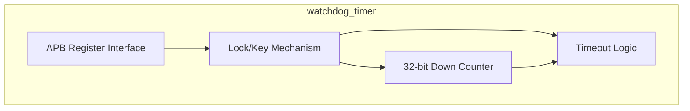
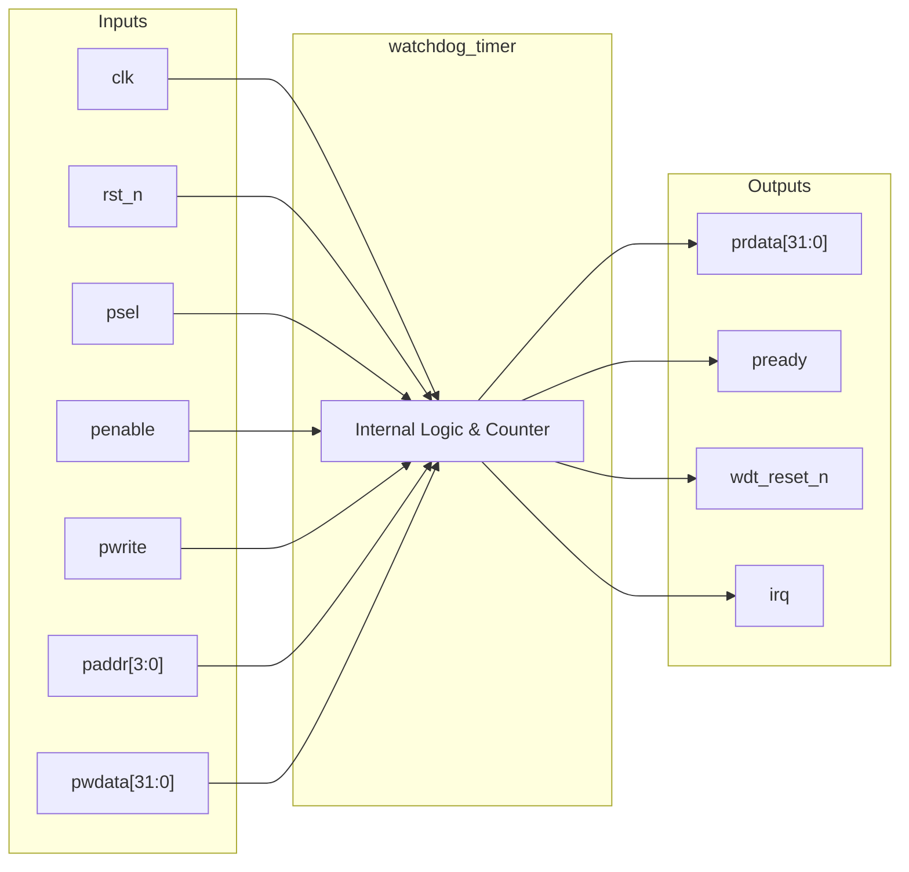
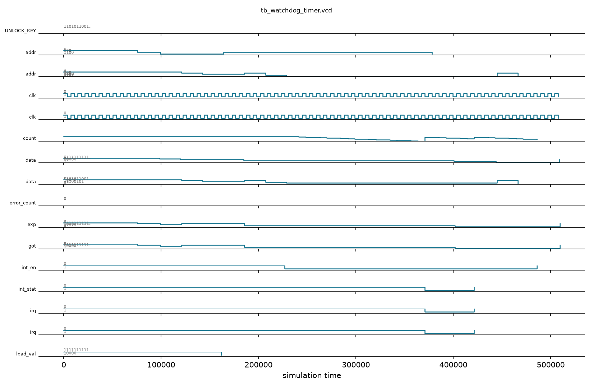

# watchdog_timer

## Description

The `watchdog_timer` is an APB-slave peripheral designed to monitor system health and recover from hangs in the SMVDU-TITAN-X SoC. It features a 32-bit down counter driven by a programmable reload value. The module implements a robust two-stage timeout mechanism: a first expiry generates an interrupt to give the system a chance to recover, while a second consecutive expiry unconditionally asserts a system reset. To prevent accidental modification of critical settings by errant code, the peripheral incorporates a lock-and-key mechanism requiring a specific 32-bit password (`0x1ACCE551`) to be written before its control registers can be altered.

## Interface

### Inputs

| Signal | Width | Description |
|--------|-------|-------------|
| clk    | 1     | System clock |
| rst_n  | 1     | Active-low asynchronous reset |
| psel   | 1     | APB select signal |
| penable| 1     | APB enable signal |
| pwrite | 1     | APB write enable signal |
| paddr  | 4     | APB address bus |
| pwdata | 32    | APB write data bus |

### Outputs

| Signal | Width | Description |
|--------|-------|-------------|
| prdata | 32    | APB read data bus |
| pready | 1     | APB ready signal, hardwired to 1 |
| wdt_reset_n | 1| Watchdog reset output; asserts low on a secondary timeout to reset the system |
| irq    | 1     | Interrupt request output; asserts high on the primary timeout |

## Functionality

The core of the watchdog is a 32-bit counter that decrements on every clock cycle when enabled (`wdt_en`). Software configures the timeout period by writing to the `load_val` register. When the counter reaches zero, the module checks `int_stat`. If `int_stat` is 0, the watchdog asserts an interrupt flag (raising `irq` if `int_en` is set), sets `int_stat` to 1, and reloads the counter. If the counter reaches zero again and `int_stat` is already 1, indicating the interrupt was not serviced, the watchdog asserts `wdt_reset_n` low. Software must routinely "kick" the watchdog by writing `0x000000E5` to the service register to reload the counter and clear `int_stat`. All write accesses to the configuration and load registers are blocked unless the unlock register is first written with the magic value `0x1ACCE551`.

## Hierarchical Block Diagram



## Signal-Level Diagram



## Verification & Test Results

### Test Strategy
The testbench (`tb_watchdog_timer.v`) verifies APB access security, down-counting, primary interrupt firing, watchdog service kicks, and reset suppression:
1. **TEST 1: Reset Baseline**: Verifies `pready=1`, `wdt_reset_n=1`, and `irq=0` following reset release.
2. **TEST 2: Default Reload Value**: Reads `load_val` (`0x4`) and verifies reset default of `0xFFFFFFFF`.
3. **TEST 3: Default Control State**: Reads `control` (`0xC`) and confirms `wdt_en=0`.
4. **TEST 4: Password Unlock & Reload Configuration**: Writes unlock key `0x1ACCE551` to `0x0`, writes reload value `16` to `load_val`, and verifies readback.
5. **TEST 5: Counter Timeout & Interrupt**: Enables watchdog and interrupt (`wdt_en=1, int_en=1`), kicks counter to 16, and confirms `irq` fires in 18 cycles upon count reaching 0.
6. **TEST 6: Status Flag Latching**: Confirms `int_stat` is set in the status register.
7. **TEST 7: Watchdog Kick (Service)**: Writes service key `0xE5` to kick register (`0x8`); verifies that `int_stat` and `irq` clear immediately.
8. **TEST 8: Reset Containment**: Confirms `wdt_reset_n` remains high (`1`) because the timer was serviced before secondary timeout.
9. **TEST 9: Watchdog Disable**: Unlocks and clears `wdt_en`; confirms counting halts.

### Simulation Transcript
```text
VCD info: dumpfile tb_watchdog_timer.vcd opened for output.

--- TEST 1: Reset state ---
PASS [76000]             pready=1 after reset
PASS [76000]        wdt_reset_n=1 after reset
PASS [76000]                irq=0 after reset

--- TEST 2: Default load_val ---
PASS [99000]  load_val=0xFFFFFFFF after reset

--- TEST 3: Default control state ---
PASS [121000]             wdt_en=0 after reset

--- TEST 4: Unlock + load_val write ---
PASS [186000]          load_val=16 after write

--- TEST 5: WDT enable + timeout interrupt ---
PASS [378000] irq=1 after WDT timeout (took 18 cycles)

--- TEST 6: int_stat set in status reg ---
PASS [402000]         int_stat=1 after timeout

--- TEST 7: Kick (service) clears int_stat ---
PASS [445000]            int_stat=0 after kick
PASS [445000]                 irq=0 after kick

--- TEST 8: wdt_reset_n stays high after single timeout ---
PASS [445000] eset_n=1 (no second timeout yet)

--- TEST 9: Disable WDT ---
PASS [510000]           wdt_en=0 after disable

==============================
WDT VERDICT: ✅ PASS — All tests passed
==============================
```

### Digital Waveform


