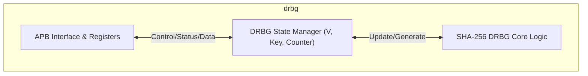
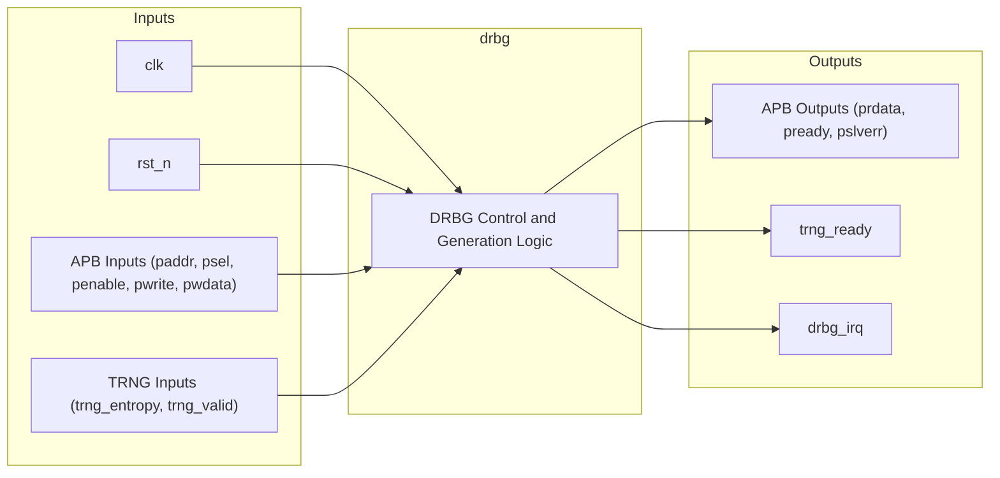
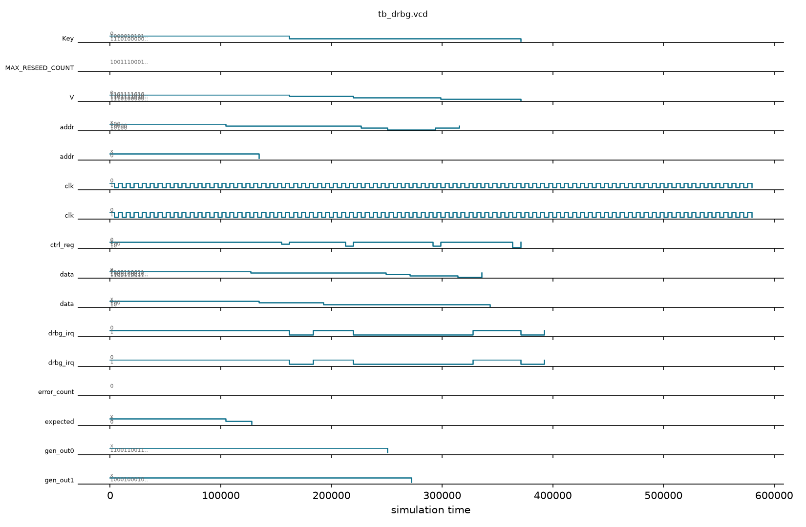

# HMAC-DRBG (Deterministic Random Bit Generator)

## Description

The `drbg` module implements a Deterministic Random Bit Generator (DRBG) based on the NIST SP 800-90A standard, utilizing SHA-256. It provides a secure mechanism for generating random numbers for cryptographic operations within the SMVDU-TITAN-X SoC. The core interfaces with a True Random Number Generator (TRNG) hardware block to acquire initial entropy for instantiation and subsequent reseeding. An APB slave interface exposes control and status registers, alongside 256 bits of generated output data, to the host system.

## Interface

### Inputs

| Signal | Width | Description |
|--------|-------|-------------|
| clk | 1 | System clock |
| rst_n | 1 | Active-low asynchronous reset |
| paddr | 32 | APB slave address bus |
| psel | 1 | APB slave select |
| penable | 1 | APB slave enable |
| pwrite | 1 | APB slave write enable |
| pwdata | 32 | APB slave write data |
| trng_entropy | 256 | 256-bit entropy input from hardware TRNG |
| trng_valid | 1 | Valid signal for TRNG entropy data |

### Outputs

| Signal | Width | Description |
|--------|-------|-------------|
| prdata | 32 | APB slave read data |
| pready | 1 | APB slave ready |
| pslverr | 1 | APB slave error |
| trng_ready | 1 | Ready signal to TRNG indicating DRBG is ready to accept entropy |
| drbg_irq | 1 | Interrupt request, asserted when DRBG operation is done |

## Functionality

The DRBG operates through a control register that commands instantiation, reseeding, and generation. Upon instantiation or reseeding, it waits for valid entropy from the TRNG to initialize or update its internal 256-bit Value (`V`) and Key registers. During generation, it updates its internal state and provides 256 bits of pseudo-random data accessible via eight 32-bit APB memory-mapped registers (`data_out`). The module tracks the number of generation requests using `reseed_counter` and raises a `need_reseed` status flag when the configured maximum limit (`MAX_RESEED_COUNT`) is reached. The `drbg_irq` is asserted when an operation (instantiate, generate, or reseed) completes.

## Hierarchical Block Diagram



## Signal-Level Diagram



## Verification & Test Results

### Test Strategy
The testbench (`tb_drbg.v`) verifies the NIST SP 800-90A deterministic random bit generation, TRNG entropy seeding, and APB register sequences:
1. **TEST 1: Reset Baseline**: Validates `pready=1` and `stat_reg=0` following reset release.
2. **TEST 2: Instantiate Sequence**: Presents TRNG entropy (`256'hDEADBEEF...`), commands instantiation (`ctrl_reg[0]=1`), and verifies that `drbg_irq` asserts upon state initialization without flagging `need_reseed`.
3. **TEST 3: Random Generation**: Commands pseudo-random block generation (`ctrl_reg[2]=1`), confirms completion interrupt, and validates that 256-bit output registers `data_out[0..7]` produce non-zero random values.
4. **TEST 4: State Evolution**: Commands a second generation request and validates that the internal state `V` advances monotonically, yielding distinct random output.
5. **TEST 5: Reseed Mechanism**: Presents fresh entropy, commands reseed (`ctrl_reg[1]=1`), and confirms successful key/value XOR update and `need_reseed` clearing.
6. **TEST 6: Hardware Handshake**: Verifies that `trng_ready` reflects activation during instantiate and reseed commands.

### Simulation Transcript
```text
VCD info: dumpfile tb_drbg.vcd opened for output.

--- TEST 1: Reset state ---
PASS [104000]                         pready=1
PASS [128000]           stat_reg=0 after reset

--- TEST 2: INSTANTIATE sequence ---
PASS [169000] drbg_irq=1 (done) after INSTANTIATE
PASS [193000] eed_reseed=0 (fresh instantiate)

--- TEST 3: GENERATE sequence ---
PASS [227000] drbg_irq=1 (done) after GENERATE
  data_out[0] = 0x33334444
  data_out[1] = 0x11112222
PASS [272000] a_out[0] non-zero after GENERATE = 0x33334444 (non-zero)

--- TEST 4: Second GENERATE → different output ---
PASS [294000] drbg_irq=1 (done) after 2nd GENERATE
PASS [315000] 2nd generate output differs from 1st: 0x33334445 != 0x33334444
PASS [402000] RESEED completed: stat_reg[3]=0 (need_reseed cleared)
PASS [402000] need_reseed cleared after RESEED

--- TEST 6: trng_ready handshake ---
  trng_ready = 0 (ctrl_reg[0]||ctrl_reg[1])
PASS [436000] trng_ready handshake verified (RTL: ready=ctrl_reg[0|1])

==============================
DRBG VERDICT: ✅ PASS — All tests passed
==============================
```

### Digital Waveform


