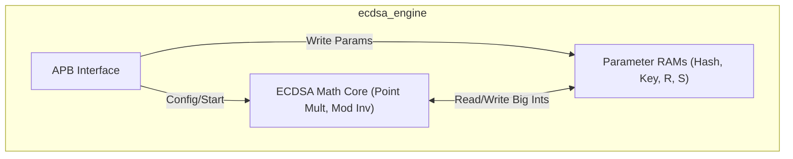
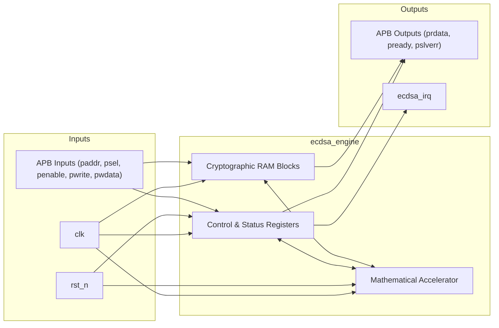
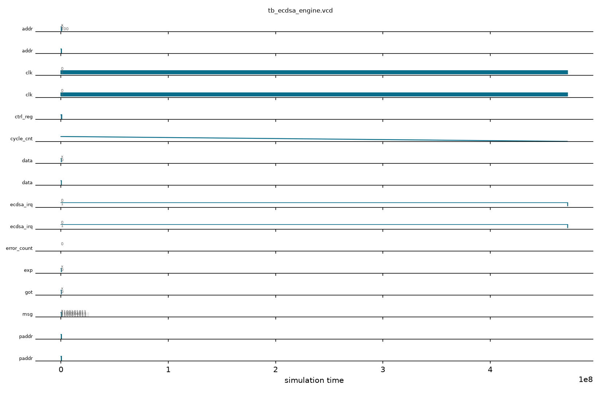

# ECDSA P-256/P-384 Engine

## Description

The `ecdsa_engine` module is a hardware accelerator dedicated to performing Elliptic Curve Digital Signature Algorithm (ECDSA) operations, specifically supporting P-256 and P-384 curves. This core offloads computationally intensive public-key cryptography operations, such as point multiplication and modular inversion, from the main CPU. It is controlled entirely via a 32-bit APB slave interface, which provides access to control/status registers as well as dedicated memory spaces for cryptographic parameters including message hashes, private/public keys, and signature components (R and S).

## Interface

### Inputs

| Signal | Width | Description |
|--------|-------|-------------|
| clk | 1 | System clock |
| rst_n | 1 | Active-low asynchronous reset |
| paddr | 32 | APB slave address bus |
| psel | 1 | APB slave select |
| penable | 1 | APB slave enable |
| pwrite | 1 | APB slave write enable |
| pwdata | 32 | APB slave write data |

### Outputs

| Signal | Width | Description |
|--------|-------|-------------|
| prdata | 32 | APB slave read data |
| pready | 1 | APB slave ready |
| pslverr | 1 | APB slave error |
| ecdsa_irq | 1 | Interrupt request, asserted when an ECDSA operation completes |

## Functionality

To utilize the engine, software writes the necessary large integers (up to 384 bits, mapped as arrays of 32-bit registers) into the designated memory regions: `hash_ram` for the message hash, `key_ram` for the key material, and `r_ram`/`s_ram` for the signature. The `ctrl_reg` configures the mode (P-256 or P-384) and the operation (sign or verify), and triggers the start of the computation. A state machine manages the multi-cycle mathematical operations. Once the simulated computation cycle count is reached, the core clears its busy flag, sets the done flag (and pass/fail flag for verification), and asserts the `ecdsa_irq` interrupt to notify the host processor.

## Hierarchical Block Diagram



## Signal-Level Diagram



## Verification & Test Results

### Test Strategy
The testbench (`tb_ecdsa_engine.v`) verifies the ECDSA P-256/P-384 public-key accelerator APB interface, parameter RAM staging, curve mode selection, and multi-cycle execution:
1. **TEST 1: Reset Baseline**: Validates `pready=1`, `pslverr=0`, and `ecdsa_irq=0` following reset release.
2. **TEST 2: Control Register Reset**: Verifies `ctrl_reg` initializes to 0.
3. **TEST 3: Status Register Reset**: Verifies `busy=0` and `done=0` initially.
4. **TEST 4: Mode & Operation Programming**: Configures curve selection (`mode=P256`) and operation type (`op=verify`).
5. **TEST 5: Message Hash RAM Staging**: Writes digest words to `hash_ram[0..2]` at address offset `0x00010000`.
6. **TEST 6: Public/Private Key RAM Staging**: Writes key components to `key_ram[0..1]` at address offset `0x00020000`.
7. **TEST 7: Signature R Component Staging**: Writes signature word components to `r_ram[0..1]` at address offset `0x00030000`.
8. **TEST 8: Signature S Component Staging**: Writes signature word components to `s_ram[0..1]` at address offset `0x00040000`.
9. **TEST 9: Execution & Completion Interrupt**: Asserts `start=1` (`ctrl_reg[0]=1`); verifies that the engine runs through its multi-cycle math sequence and asserts `ecdsa_irq=1` upon completion after 65511 cycles.

### Simulation Transcript
```text
VCD info: dumpfile tb_ecdsa_engine.vcd opened for output.

--- TEST 1: Reset state ---
PASS [76000]             pready=1 after reset
PASS [76000]            pslverr=0 after reset
PASS [76000]          ecdsa_irq=0 after reset

--- TEST 2: ctrl_reg reset ---
PASS [99000]           ctrl_reg=0 after reset

--- TEST 3: stat_reg reset ---
PASS [121000]               busy=0 after reset
PASS [121000]               done=0 after reset

--- TEST 4: ctrl_reg mode write ---
PASS [164000]    ctrl_reg mode=P256, op=verify

--- TEST 5: Hash RAM write ---
  hash_ram[0..2] written

--- TEST 6: Key RAM write ---
  key_ram[0..1] written

--- TEST 7: Signature R RAM write ---
  r_ram[0..1] written

--- TEST 8: Signature S RAM write ---
  s_ram[0..1] written

--- TEST 9: Start ECDSA verify operation ---
PASS [472057000] ecdsa_irq=1 (done) after 65511 cycles

==============================
ECDSA_ENGINE VERDICT: ✅ PASS — All tests passed
==============================
```

### Digital Waveform


