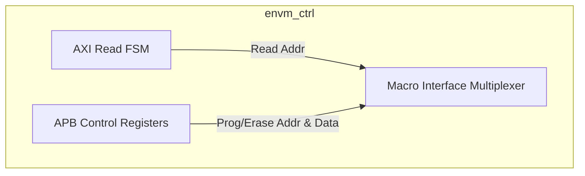
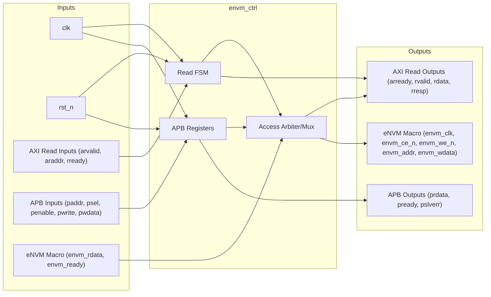
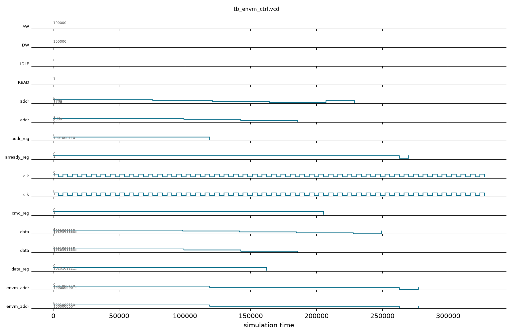

# eNVM Controller

## Description

The `envm_ctrl` module is the controller for a 128KB Embedded Non-Volatile Memory (eNVM) macro. It provides a dual-interface architecture: a high-speed AXI4-Lite slave interface optimized for fast, direct read access (typically used for instruction execution or boot ROM), and an APB slave interface dedicated to slower management operations such as programming and erasing memory sectors. It handles the translation of bus transactions into the specific physical control signals required by the underlying eNVM hardware macro.

## Interface

### Inputs

| Signal | Width | Description |
|--------|-------|-------------|
| clk | 1 | System clock |
| rst_n | 1 | Active-low asynchronous reset |
| s_arvalid | 1 | AXI4-Lite read address valid |
| s_araddr | AW | AXI4-Lite read address (AW=32) |
| s_rready | 1 | AXI4-Lite read data ready |
| paddr | 32 | APB slave address bus |
| psel | 1 | APB slave select |
| penable | 1 | APB slave enable |
| pwrite | 1 | APB slave write enable |
| pwdata | 32 | APB slave write data |
| envm_rdata | 32 | 32-bit read data from physical eNVM macro |
| envm_ready | 1 | Ready signal from physical eNVM macro |

### Outputs

| Signal | Width | Description |
|--------|-------|-------------|
| s_arready | 1 | AXI4-Lite read address ready |
| s_rvalid | 1 | AXI4-Lite read data valid |
| s_rdata | DW | AXI4-Lite read data (DW=32) |
| s_rresp | 2 | AXI4-Lite read response |
| prdata | 32 | APB slave read data |
| pready | 1 | APB slave ready |
| pslverr | 1 | APB slave error |
| envm_clk | 1 | Clock signal routed to eNVM macro |
| envm_ce_n | 1 | Active-low chip enable for eNVM macro |
| envm_we_n | 1 | Active-low write enable for eNVM macro |
| envm_addr | 17 | 17-bit physical word address to eNVM macro |
| envm_wdata | 32 | 32-bit write data to eNVM macro |

## Functionality

The controller arbitrates between read requests from the AXI bus and management commands from the APB bus, with AXI reads structurally given priority in this behavioral model. During an AXI read, the controller's simple FSM translates the `s_araddr` into the physical `envm_addr`, asserts `envm_ce_n`, and registers the returned `envm_rdata` to the AXI `s_rdata` bus, signaling completion via `s_rvalid`. The APB interface decodes accesses to a set of control registers (`cmd_reg`, `addr_reg`, `data_reg`, `unlock_reg`, and `stat_reg`). To program or erase the eNVM, software must write a specific magic value to the unlock register before issuing commands, mitigating accidental corruption of the non-volatile memory.

## Hierarchical Block Diagram



## Signal-Level Diagram



## Verification & Test Results

### Test Strategy
The testbench (`tb_envm_ctrl.v`) verifies the dual-bus architecture: high-speed AXI4-Lite read datapath and APB-based control/programming plane:
1. **TEST 1: APB Handshake**: Verifies `pready=1` and `pslverr=0` following reset release.
2. **TEST 2: Command Register Reset**: Confirms `cmd_reg` resets to `0x00000000`.
3. **TEST 3: Target Address Register R/W**: Writes word offset `0x00001234` to `addr_reg` and verifies readback.
4. **TEST 4: Write Data Register R/W**: Writes payload word `0xABCD1234` to `data_reg` and verifies readback.
5. **TEST 5: Command Register R/W**: Writes command word `0x00000001` to `cmd_reg` and verifies readback.
6. **TEST 6: Status Register Polling**: Reads status register (`0x0C`) confirming `busy=0` during idle.
7. **TEST 7: AXI-Lite eNVM Memory Read**: Initiates an AXI-Lite read at address `0x100`; validates that the read FSM translates the address to `envm_addr`, samples external memory data `0xDEADCAFE`, and drives `s_rdata` with `s_rvalid`.
8. **TEST 8: Macro Interface Defaults**: Verifies physical signals (`envm_ce_n=1`, `envm_we_n=1`) default to inactive states when bus is idle.

### Simulation Transcript
```text
VCD info: dumpfile tb_envm_ctrl.vcd opened for output.

--- TEST 1: Reset state ---
PASS [76000]             pready=1 after reset
PASS [76000]            pslverr=0 after reset

--- TEST 2: cmd_reg reset ---
PASS [99000]            cmd_reg=0 after reset

--- TEST 3: addr_reg write/readback ---
PASS [142000]      addr_reg=0x1234 after write

--- TEST 4: data_reg write/readback ---
PASS [186000]  data_reg=0xABCD1234 after write

--- TEST 5: cmd_reg write ---
PASS [229000]            cmd_reg=1 after write

--- TEST 6: stat_reg readable ---
  stat_reg = 0x00000000 (busy=0)

--- TEST 7: AXI-Lite eNVM read ---
PASS [277000] AXI read: s_rdata=0xdeadcafe (envm_rdata=0xdeadcafe)

--- TEST 8: envm interface signals ---
  envm_clk=1 envm_ce_n=1 envm_we_n=1
PASS [328000]  envm_we_n=1 (no writes via APB)

==============================
ENVM_CTRL VERDICT: ✅ PASS — All tests passed
==============================
```

### Digital Waveform


