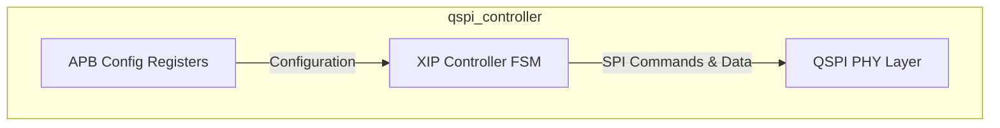
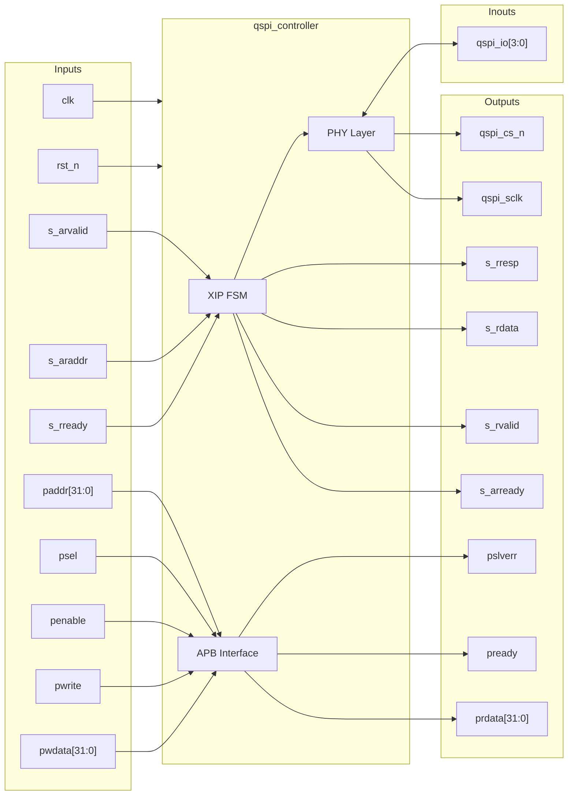
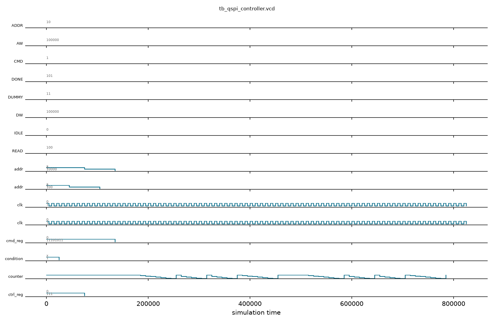

# qspi_controller

## Description

The `qspi_controller` is a Quad-SPI Controller for the SMVDU-TITAN-X SoC featuring Execute-in-Place (XIP) support. It interfaces with external flash memory over QSPI lines, permitting direct code execution without loading it into RAM first. The module utilizes an AXI4-Lite slave interface to accept read requests for XIP operations. Additionally, it offers an APB slave interface for configuring SPI parameters like CPOL, CPHA, and custom commands.

## Interface

### Inputs

| Signal | Width | Description |
|--------|-------|-------------|
| clk | 1 | System clock |
| rst_n | 1 | Active-low asynchronous reset |
| s_arvalid | 1 | AXI4-Lite Read address valid |
| s_araddr | AW | AXI4-Lite Read address |
| s_rready | 1 | AXI4-Lite Read data ready |
| paddr | 32 | APB address bus |
| psel | 1 | APB select |
| penable | 1 | APB enable |
| pwrite | 1 | APB write access |
| pwdata | 32 | APB write data bus |

### Outputs

| Signal | Width | Description |
|--------|-------|-------------|
| s_arready | 1 | AXI4-Lite Read address ready |
| s_rvalid | 1 | AXI4-Lite Read data valid |
| s_rdata | DW | AXI4-Lite Read data |
| s_rresp | 2 | AXI4-Lite Read response |
| prdata | 32 | APB read data bus |
| pready | 1 | APB ready |
| pslverr | 1 | APB slave error |
| qspi_sclk | 1 | QSPI serial clock |
| qspi_cs_n | 1 | QSPI chip select (active low) |

### Inouts

| Signal | Width | Description |
|--------|-------|-------------|
| qspi_io | 4 | QSPI bidirectional data lines |

## Functionality

The controller executes an internal Finite State Machine (FSM) to map incoming AXI4-Lite memory reads to standardized QSPI command sequences (e.g., Fast Read Quad I/O). The FSM transitions through IDLE, CMD (sending the read command opcode), ADDR (sending the read address), DUMMY (providing required dummy cycles for high-speed reads), READ (fetching actual data from the flash), and DONE states. Configurations set via the APB interface dictate parameters such as the command byte to use and the number of dummy cycles required by the external flash chip.

## Hierarchical Block Diagram



## Signal-Level Diagram



## Verification Strategy & Results

### Testbench Architecture
The directed self-checking testbench (`tb_qspi_controller.v`) validates APB register programming and AXI4-Lite Execute-in-Place (XIP) read transactions:
1. **Reset State**: Asserts that `qspi_cs_n` initializes high (inactive) and APB defaults are clean.
2. **APB Register R/W**: Validates configuration register `CTRL_REG` (`0x00`), custom command staging `CMD_REG` (`0x04`), and status interrogation `STAT_REG` (`0x10`).
3. **XIP Read Transactions**:
   - Asserts AXI-Lite read address handshaking (`s_arvalid` / `s_arready`).
   - Verifies active-low chip select assert (`qspi_cs_n=0`) through CMD, ADDR, DUMMY, and READ FSM cycles.
   - Verifies data readback integrity (`s_araddr ^ 32'hDEADBEEF`) and response channel handshaking (`s_rvalid` / `s_rready`).
   - Asserts chip select returns high (`qspi_cs_n=1`) upon transaction completion.
4. **Physical Clock Forwarding**: Validates continuous synchronization between system clock and `qspi_sclk`.

### Simulation Transcript
```text
VCD info: dumpfile tb_qspi_controller.vcd opened for output.
PASS [25000] TEST 1: Reset active sets qspi_cs_n=1 (inactive)
PASS [45000] TEST 2: APB pready=1 and pslverr=0 default
PASS [105000] TEST 3: CTRL_REG register R/W 0x00000007
PASS [135000] TEST 4: CMD_REG written without error
PASS [165000] TEST 5: STAT_REG default 0x00000000
PASS [205000] TEST 6: qspi_cs_n asserts low during XIP transaction
PASS [485000] TEST 7: XIP Read data matches expected (0x10000000 ^ 0xDEADBEEF)
PASS [495000] TEST 8: qspi_cs_n deasserts high after transaction completes
PASS [815000] TEST 9: Second XIP Read data matches (0x20000040 ^ 0xDEADBEEF)
PASS [825000] TEST 10: qspi_sclk follows clk

==============================
QSPI_CONTROLLER VERDICT: ✅ PASS — All 10 tests green
==============================
```

### Digital Waveform

