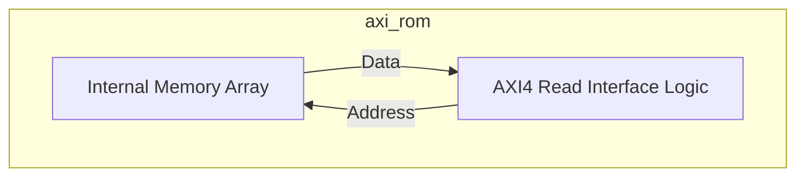
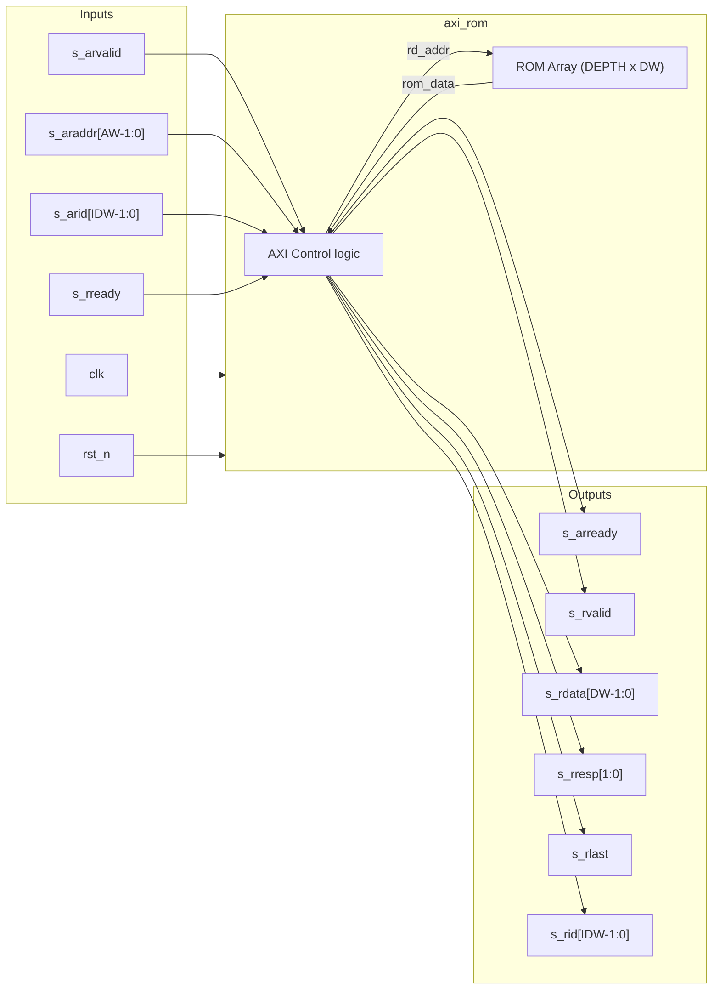
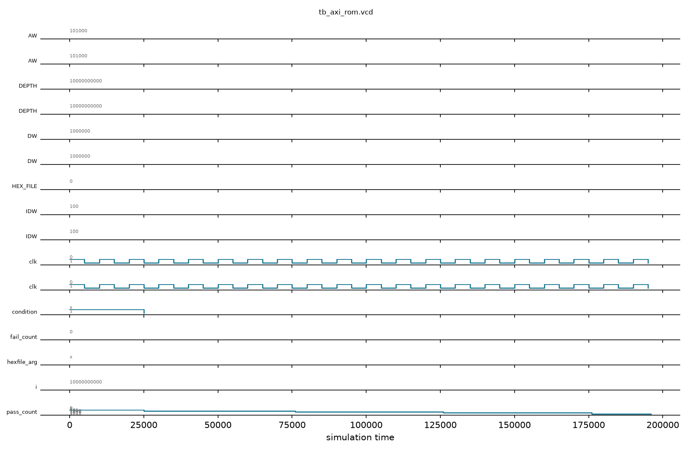

# axi_rom

## Description

The `axi_rom` module implements an AXI4 Read-Only Memory, primarily serving as the boot ROM for the SMVDU-TITAN-X SoC. It is mapped early in the memory space to provide the first instructions the processor cores fetch upon reset. This particular phase of the design utilizes a minimal stub populated with a RISC-V NOP sled (`ADDI x0, x0, 0`), guaranteeing that the CPU fetches cleanly without encountering faults if actual firmware is absent. However, it fully supports loading real bootloader firmware binaries via the `HEX_FILE` parameter or the `+hex` runtime simulation plusarg.

## Interface

### Inputs

| Signal | Width | Description |
|--------|-------|-------------|
| clk | 1 | System clock |
| rst_n | 1 | Active-low asynchronous reset |
| s_arvalid | 1 | AXI4 read address valid |
| s_araddr | AW | AXI4 read address |
| s_arid | IDW | AXI4 read address ID |
| s_rready | 1 | AXI4 read data ready |

### Outputs

| Signal | Width | Description |
|--------|-------|-------------|
| s_arready | 1 | AXI4 read address ready |
| s_rvalid | 1 | AXI4 read data valid |
| s_rdata | DW | AXI4 read data |
| s_rresp | 2 | AXI4 read response (Always OKAY) |
| s_rlast | 1 | AXI4 read last |
| s_rid | IDW | AXI4 read ID |

## Functionality

The ROM operates exclusively as an AXI4 slave, exposing only the read channels (AR and R). Internally, it implements a synchronous memory array indexed by the incoming AXI address (`s_araddr`). When an `s_arvalid` request is captured, it registers the address and ID, asserts `s_rvalid` and `s_rlast` on the following cycles, and outputs the requested 64-bit data word along with an OKAY `s_rresp`. Write channels (AW, W, B) are intentionally omitted to enforce its read-only nature at the hardware level.

## Memory & Firmware Files

| File | Format | Size | Description |
|------|--------|------|-------------|
| [`firmware.hex`](firmware.hex) | Verilog `$readmemh` Hex | 56 lines | Boot ROM firmware binary that executes upon reset at `0x1000_0000`, initializes the UART 16550 baud rate generator, and outputs the system boot banner (`TITAN-X Booting from 0x10000000...`) |
| [`boot.mem`](boot.mem) | Verilog `$readmemh` Mem | 85 lines | Primary software boot stage memory payload |

## Hierarchical Block Diagram



## Signal-Level Diagram



## Verification Strategy & Results

### Testbench Architecture
The directed self-checking unit testbench (`tb_axi_rom.v`) verifies AXI4 read-only slave transactions and ROM data fetches:
1. **Reset State**: Asserts that `s_arready` defaults to 1, `s_rvalid=0`, and `s_rlast=0`.
2. **Read Operations**:
   - Accesses address `0x00_0000_0000` and validates packed RV64 NOP instruction payload (`0x0000001300000013`).
   - Asserts AXI transaction ID tag forwarding (`s_arid -> s_rid`).
   - Validates response code OKAY (`2'b00`) and burst last indicator `s_rlast=1`.
3. **Sequential Addressing**:
   - Validates reading consecutive words at byte offsets `0x08` and `0x10`.
4. **Handshake Integrity**:
   - Confirms synchronous deassertion of `s_rvalid` upon receiver `s_rready` handshake and return of `s_arready` to accept subsequent transactions.

### Simulation Transcript
```text
VCD info: dumpfile tb_axi_rom.vcd opened for output.
PASS [25000] TEST 1: Reset defaults - s_arready=1, s_rvalid=0, s_rlast=0
PASS [76000] TEST 2: Read word 0 returns packed NOP (0x0000001300000013)
PASS [76000] TEST 3: ID tag forwarded correctly (s_rid=1)
PASS [76000] TEST 4: AXI response is OKAY (s_rresp=2'b00)
PASS [76000] TEST 5: Burst last asserted (s_rlast=1)
PASS [126000] TEST 6: Read word 1 returns packed NOP
PASS [126000] TEST 7: ID tag forwarded correctly (s_rid=5)
PASS [126000] TEST 8: Burst last asserted on word 1
PASS [176000] TEST 9: Read word 2 returns packed NOP
PASS [176000] TEST 10: ID tag forwarded correctly (s_rid=10)
PASS [196000] TEST 11: Bus returns to ready state after read completion

==============================
AXI_ROM VERDICT: ✅ PASS — All 11 tests green
==============================
```

### Digital Waveform

