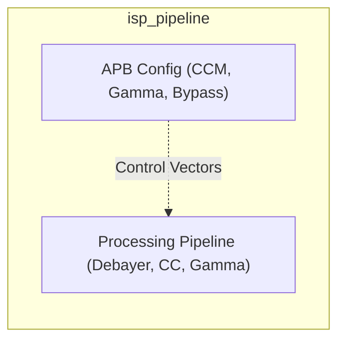
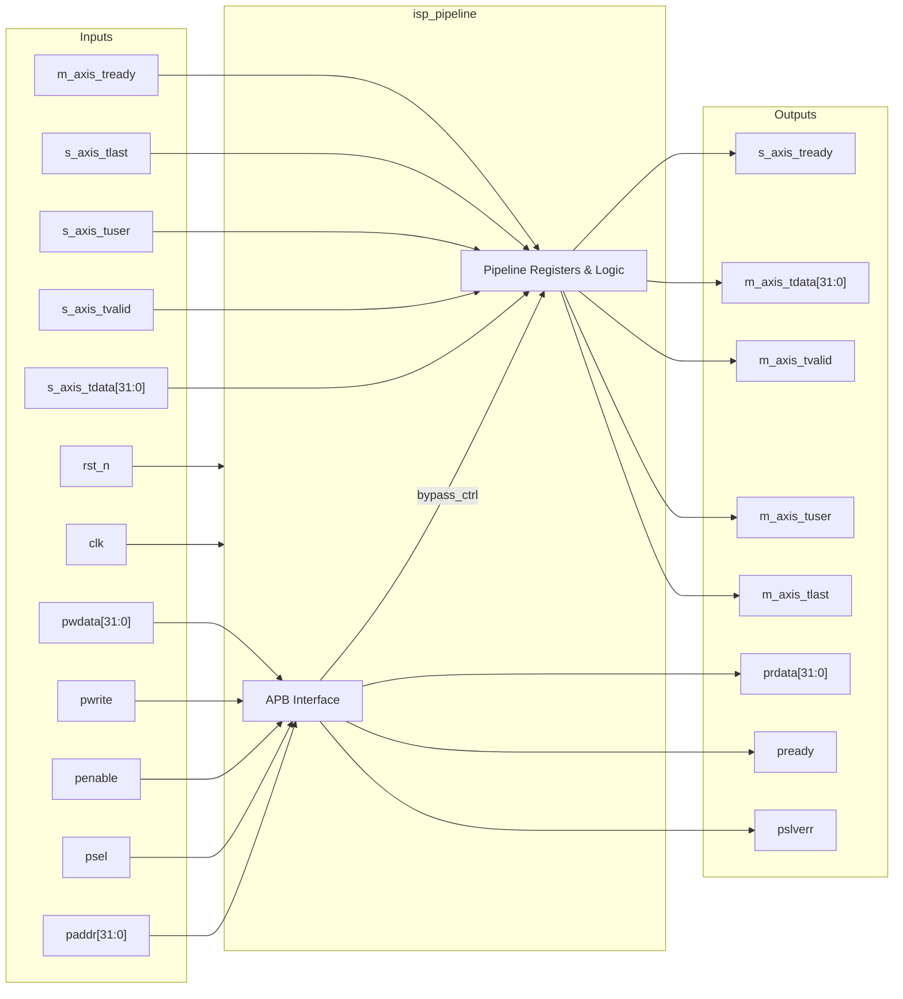
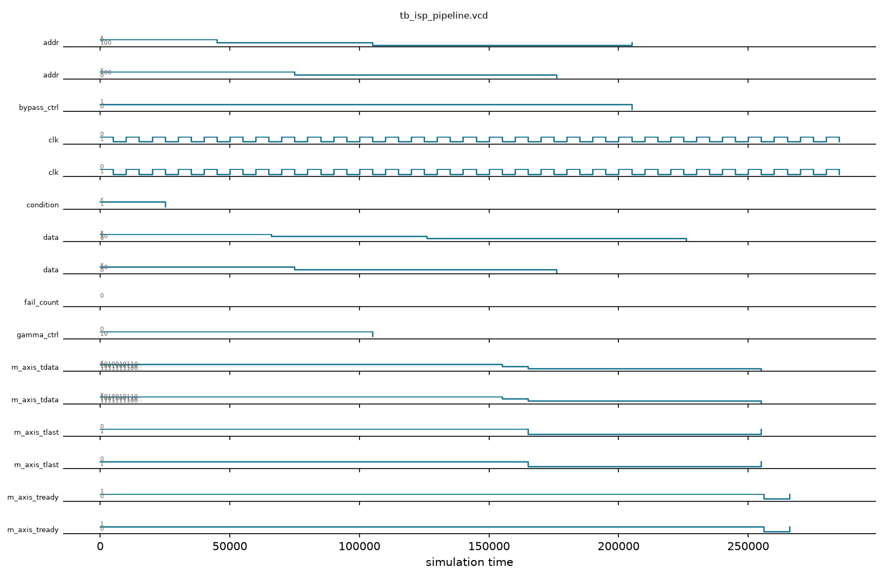

# isp_pipeline

## Description

The `isp_pipeline` module acts as the Image Signal Processor for the SMVDU-TITAN-X SoC. Placed primarily between a MIPI CSI-2 receiver and Video DMA storage, it processes raw camera feeds. Key conceptual stages of this pipeline include Debayering (Bayer to RGB interpolation), Color Correction using a 3x3 matrix, and Gamma Correction using Lookup Tables (LUT). It receives and transmits streams via AXI4-Stream interfaces and can be tuned or bypassed altogether via an APB configuration interface. 

## Interface

### Inputs

| Signal | Width | Description |
|--------|-------|-------------|
| clk | 1 | System clock |
| rst_n | 1 | Active-low asynchronous reset |
| s_axis_tdata | 32 | AXI4-Stream incoming video data |
| s_axis_tvalid | 1 | AXI4-Stream incoming valid |
| s_axis_tuser | 1 | AXI4-Stream user signal - Indicates Start of Frame (SOF) |
| s_axis_tlast | 1 | AXI4-Stream last signal - Indicates End of Line (EOL) |
| m_axis_tready | 1 | AXI4-Stream downstream ready - Indicates readiness to accept processed data |
| paddr | 32 | APB address bus |
| psel | 1 | APB select |
| penable | 1 | APB enable |
| pwrite | 1 | APB write access |
| pwdata | 32 | APB write data bus |

### Outputs

| Signal | Width | Description |
|--------|-------|-------------|
| s_axis_tready | 1 | AXI4-Stream upstream ready - Indicates module can accept new data |
| m_axis_tdata | 32 | AXI4-Stream processed output video data |
| m_axis_tvalid | 1 | AXI4-Stream output valid |
| m_axis_tuser | 1 | AXI4-Stream output user signal (SOF) |
| m_axis_tlast | 1 | AXI4-Stream output last signal (EOL) |
| prdata | 32 | APB read data bus |
| pready | 1 | APB ready |
| pslverr | 1 | APB slave error |

## Functionality

The ISP Pipeline implements configurable processing stages. Internal state is modified by the APB bus, allowing dynamic tuning of color correction matrices (CCM), gamma lookups, or global bypass capabilities (`bypass_ctrl`). The AXI4-Stream data handling includes a registered pipeline that propagates frame framing metadata (`tuser`, `tlast`) alongside the pixel data (`tdata`). In the current mock implementation, bypassing copies raw data verbatim, while processing acts as a simple pixel inversion. A complete implementation builds line buffers and matrix multipliers here for authentic image tuning. Backpressure is natively handled by integrating `m_axis_tready` into the upstream `s_axis_tready` logic.

## Hierarchical Block Diagram



## Signal-Level Diagram



## Verification Strategy & Results

### Testbench Architecture
The directed self-checking testbench (`tb_isp_pipeline.v`) exercises the video processing datapath across bypass and active transformation modes:
1. **Reset State**: Asserts that `m_axis_tvalid` is held low during reset and upstream ready `s_axis_tready` initializes high.
2. **APB Register Interface**: Validates power-on default of `bypass_ctrl=1` and registers R/W for `gamma_ctrl` (`0x04`).
3. **Bypass Mode Datapath**:
   - Asserts zero-distortion passthrough of incoming pixel data (`0xA5A55A5A` and `0x12345678`).
   - Asserts frame framing propagation for start of frame (`tuser`) and end of line (`tlast`).
4. **Active ISP Processing Mode**:
   - Clears `bypass_ctrl` to 0 via APB command.
   - Validates pixel transformations in the datapath (`0x00FFAA55 -> 0xFF0055AA`).
5. **Backpressure & Flow Control**:
   - Drops `m_axis_tready` downstream and verifies pipeline deasserts upstream `s_axis_tready` without dropping payload.
   - Restores downstream ready and verifies smooth pipeline drain.

### Simulation Transcript
```text
VCD info: dumpfile tb_isp_pipeline.vcd opened for output.
PASS [25000] TEST 1: Reset holds m_axis_tvalid=0 and s_axis_tready=1
PASS [75000] TEST 2: APB bypass_ctrl defaults to 1 (passthrough mode)
PASS [135000] TEST 3: APB gamma_ctrl R/W 0x00000002
PASS [156000] TEST 4: Bypass mode propagates pixel unchanged with SOF flag
PASS [166000] TEST 5: Bypass mode propagates EOL flag
PASS [176000] TEST 6: Stream idles when s_axis_tvalid drops
PASS [235000] TEST 7: APB bypass_ctrl cleared to 0 (active processing)
PASS [256000] TEST 8: Active processing inverts pixel (0x00FFAA55 -> 0xFF0055AA)
PASS [266000] TEST 9: Backpressure from downstream asserts stall on upstream s_axis_tready
PASS [286000] TEST 10: Releasing backpressure drains pipeline and restores s_axis_tready

==============================
ISP_PIPELINE VERDICT: ✅ PASS — All 10 tests green
==============================
```

### Digital Waveform

